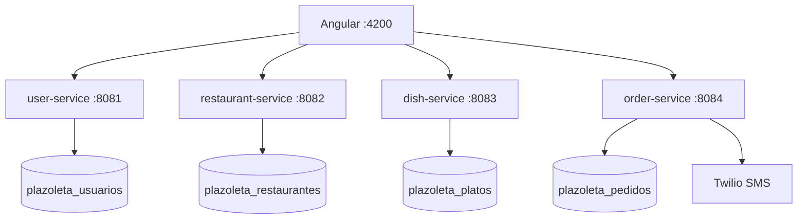

# Plaza de Comidas — Sistema de Gestión de Pedidos

Sistema académico de gestión de restaurantes, usuarios, platos y pedidos, construido con cuatro microservicios Spring Boot y un frontend Angular. Incluye seguimiento de pedidos, indicadores operativos y entrega mediante PIN enviado por SMS con Twilio.

Este repositorio es el punto de entrada para instalar, configurar, ejecutar y evaluar el sistema completo en Windows, sin Docker.

## Instalación rápida

1. Instalar Git, JDK 21, Node.js 24, PowerShell 7.5 o superior y MySQL Server con su cliente `mysql.exe`.
2. Disponer de acceso a los cinco repositorios y a una cuenta Twilio autorizada para el remitente configurado. MySQL Workbench es opcional y no sustituye al servidor.
3. Abrir PowerShell 7 (`pwsh`) en una carpeta de trabajo y ejecutar:

```powershell
git clone https://github.com/khaos80/plazoleta-frontend.git
cd plazoleta-frontend
.\scripts\iniciar-proyecto.ps1
```

En el primer inicio, responder las solicitudes de configuración de Twilio, MySQL (si requiere aprovisionamiento) y administrador inicial. Las claves RSA y el token interno se generan automáticamente. Elegir **S** cuando se solicite crear un administrador en una base vacía; introducir datos y contraseña propios. No existen credenciales universales de demostración.

Abrir [http://localhost:4200](http://localhost:4200). Para detener el sistema, desde la misma carpeta:

```powershell
.\scripts\detener-proyecto.ps1
```

> El arranque y la detención han sido validados en una instalación existente. La instalación integral desde un equipo limpio y el bootstrap de un administrador nuevo aún deben verificarse. Los scripts deben estar publicados en GitHub antes de utilizar este procedimiento desde un clon nuevo.

## Índice

- [Requisitos y repositorios](#1-requisitos-y-repositorios)
- [Automatización y configuración](#2-automatización-y-configuración)
- [Base de datos MySQL](#3-base-de-datos-mysql)
- [Inicio y detención](#4-inicio-y-detención)
- [Diagnóstico](#5-diagnóstico)
- [Documentación técnica y funcional](#6-información-general)

## 1. Requisitos y repositorios

| Herramienta | Requisito del entorno automatizado |
|---|---|
| Sistema operativo | Windows |
| PowerShell | 7.5 o superior (validado con 7.7.0) |
| Java | JDK 21, con JAVA_HOME y PATH configurados |
| Node.js | 24.x |
| npm | Incluido con Node.js; disponible como npm.cmd |
| Angular | 21, CLI local instalada mediante npm ci |
| Maven | Maven Wrapper incluido en cada microservicio |
| MySQL | Servidor local y cliente mysql.exe, puerto 3306 |
| Git | Disponible en PATH |
| Internet | Acceso a GitHub, dependencias Maven/npm y Twilio |

Descargas oficiales: [Java](https://adoptium.net/), [Node.js](https://nodejs.org/), [PowerShell](https://github.com/PowerShell/PowerShell/releases), [MySQL](https://dev.mysql.com/downloads/), [Git](https://git-scm.com/downloads).

Instalar PowerShell si no está disponible:

```powershell
winget install --id Microsoft.PowerShell --exact
```

Abrir una nueva terminal y comprobar:

```powershell
pwsh
$PSVersionTable.PSVersion
java -version
$env:JAVA_HOME
node --version
npm --version
git --version
```

| Repositorio | Puerto | Responsabilidad |
|---|---:|---|
| [plazoleta-frontend](https://github.com/khaos80/plazoleta-frontend) | 4200 | Interfaz y automatización |
| [user-service](https://github.com/khaos80/user-service) | 8081 | Usuarios, autenticación y roles |
| [restaurant-service](https://github.com/khaos80/restaurant-service) | 8082 | Restaurantes |
| [dish-service](https://github.com/khaos80/dish-service) | 8083 | Platos |
| [order-service](https://github.com/khaos80/order-service) | 8084 | Pedidos, SMS y trazabilidad |

El script de clonación organiza los repositorios como carpetas hermanas y conserva los repositorios existentes sin sobrescribir sus cambios locales. Si son privados, el evaluador debe contar con permisos de acceso.

```text
PlazaDeComidas/
├── user-service/
├── restaurant-service/
├── dish-service/
├── order-service/
└── plazoleta-frontend/
    ├── database/
    ├── scripts/
    ├── src/
    └── README.md
```

## 2. Automatización y configuración

| Script en scripts/ | Función |
|---|---|
| clonar-microservicios.ps1 | Clona o verifica los cuatro repositorios |
| configurar-entorno.ps1 | Genera y carga configuración local |
| configurar-twilio.ps1 | Solicita y reutiliza credenciales SMS |
| configurar-mysql.ps1 | Verifica o aprovisiona esquemas, tablas y usuario |
| iniciar-proyecto.ps1 | Coordina instalación, compilación y arranque |
| detener-proyecto.ps1 | Detiene procesos registrados y verifica puertos |

### 2.1. Variables de entorno y claves RSA

```powershell
.\scripts\configurar-entorno.ps1
```

| Variable | Configuración |
|---|---|
| DB_USERNAME | plazoleta_app |
| DB_PASSWORD | Contraseña aleatoria de 48 caracteres hexadecimales en una instalación nueva |
| JWT_PRIVATE_KEY | RSA 2048, PKCS#8 en Base64 |
| JWT_PUBLIC_KEY | Clave pública correspondiente, X.509 en Base64 |
| INTERNAL_SERVICE_TOKEN | Token aleatorio de 64 caracteres hexadecimales |

La configuración se conserva en `%LOCALAPPDATA%\Plazoleta\entorno.local.json`. Las variables se cargan en la sesión actual y se heredan por los procesos backend iniciados desde ella. No se crean variables globales permanentes de Windows. En una nueva sesión, volver a ejecutar el script o el iniciador general; se reutilizan los valores existentes.

No eliminar este archivo sin planificar la recuperación de la contraseña MySQL y las claves JWT. La regeneración de claves invalida los tokens anteriores. El JSON contiene secretos en texto legible: mantenerlo fuera del repositorio y restringir su acceso al usuario local.

### 2.2. Twilio

```powershell
.\scripts\configurar-twilio.ps1
```

La primera ejecución solicita Account SID y Auth Token. El remitente está predefinido en el script para la cuenta utilizada en el proyecto; debe pertenecer a la cuenta autorizada. Para utilizar otra cuenta con otro remitente, adaptar ese valor antes de reconfigurar.

| Variable | Uso |
|---|---|
| TWILIO_ACCOUNT_SID | Identificador de cuenta |
| TWILIO_AUTH_TOKEN | Credencial de autenticación |
| TWILIO_FROM_NUMBER | Remitente autorizado en formato E.164 |
| SMS_PROVEEDOR | twilio para envío real |

El archivo `%LOCALAPPDATA%\Plazoleta\twilio.local.json` conserva la configuración y protege el Auth Token mediante DPAPI de Windows. No es portable a otro usuario o equipo. En otro PC se deben introducir las credenciales autorizadas una vez; no se publican en GitHub. Para sustituirlas:

```powershell
.\scripts\configurar-twilio.ps1 -Reconfigurar
```

Verificar saldo, permisos geográficos para Colombia y autorización del remitente. Los envíos reales pueden generar cargos. Los celulares colombianos admiten diez dígitos iniciando en 3 o el prefijo +57 seguido de esos diez dígitos, sin espacios. El backend normaliza el destino a E.164.

Al pasar un pedido a LISTO, order-service genera el PIN y persiste el estado antes de solicitar el SMS. Si el proveedor falla, el pedido permanece LISTO y se registra el error; no asumir que el SMS llegó. La aceptación por Twilio no equivale a entrega al teléfono. El PIN correcto permite confirmar la entrega. Las pruebas utilizan el proveedor simulado y no generan SMS reales.

### 2.3. Administrador inicial

El iniciador solicita nombre, apellido, documento, celular, fecha de nacimiento (AAAA-MM-DD), correo y contraseña cuando se elige configurar un administrador. La contraseña debe tener al menos ocho caracteres y no superar 72 bytes UTF-8. Se conserva localmente en `administrador.local.json` con la contraseña protegida mediante DPAPI. El backend recibe los parámetros bootstrap mediante SPRING_APPLICATION_JSON y almacena la contraseña con BCrypt.

Si ya existe un administrador, el backend no lo modifica. Reconfigurar los datos locales no cambia la contraseña de una cuenta existente. No omitir el bootstrap en una base vacía si se necesita iniciar sesión como administrador.

## 3. Base de datos MySQL

### 3.1. Preparar el servidor

Instalar MySQL Server para Windows, configurar el servicio, puerto TCP 3306 y una contraseña administrativa propia. Instalar también el cliente de línea de comandos. Workbench puede utilizarse para inspeccionar los esquemas, pero no es obligatorio.

```powershell
Get-Service | Where-Object { $_.Name -like '*mysql*' }
Test-NetConnection localhost -Port 3306
.\scripts\configurar-mysql.ps1
```

El script localiza mysql.exe y el servicio MySQL, inicia el servicio si es necesario (puede requerir permisos de Windows) y comprueba la conexión. Si la cuenta de aplicación y las siete tablas ya están disponibles, reutiliza la instalación sin solicitar contraseña administrativa. Si faltan recursos o permisos, se necesita una cuenta administrativa autorizada para crearlos. No se puede deducir ni evitar una contraseña root desconocida: solicitar apoyo al administrador del equipo. No restablecer root ni modificar instalaciones ajenas.

Si hay varias instalaciones MySQL, indicar la ruta y el nombre del servicio correctos:

```powershell
.\scripts\configurar-mysql.ps1 -MySqlExe 'C:\ruta\mysql.exe' -Servicio 'NombreDelServicio'
```

### 3.2. Esquemas y tablas

| Esquema | Tablas |
|---|---|
| plazoleta_usuarios | usuarios |
| plazoleta_restaurantes | restaurantes |
| plazoleta_platos | platos |
| plazoleta_pedidos | pedidos, detalles_pedido, pedido_estado_historial, bloqueos_cliente |

Los scripts SQL incluidos se ejecutan en este orden:

| Archivo en database/ | Operación |
|---|---|
| 01-crear-bases-datos.sql | Crea los cuatro esquemas utf8mb4 |
| 02-crear-tabla-usuarios.sql | Crea usuarios, roles y restricciones únicas |
| 03-crear-tabla-restaurantes.sql | Crea restaurantes y restricciones de NIT y propietario |
| 04-crear-tabla-platos.sql | Crea platos, disponibilidad y referencia al restaurante |
| 05-crear-tablas-pedidos.sql | Crea pedidos, detalles, historial y bloqueos |

Las sentencias usan CREATE DATABASE/TABLE IF NOT EXISTS e InnoDB. No contienen DROP ni eliminación de registros. No constituyen una migración de esquemas incompatibles. La relación física de detalles_pedido.pedido_id referencia pedidos.id; las referencias entre dominios se validan mediante los servicios correspondientes.

El usuario `plazoleta_app` recibe permisos limitados a los cuatro esquemas: SELECT, INSERT, UPDATE, DELETE, CREATE, ALTER, INDEX y REFERENCES. No se necesita ejecutar los microservicios como root. Si el usuario ya existe con otra contraseña, conservarla y ajustar de forma local DB_PASSWORD en entorno.local.json con la credencial autorizada; no cambiarla automáticamente. En caso de discrepancia, detener la instalación y revisar la configuración.

### 3.3. Inspección opcional en Workbench

Conectar a localhost:3306 con una cuenta autorizada y ejecutar:

```sql
SHOW DATABASES;
SHOW TABLES FROM plazoleta_usuarios;
SHOW TABLES FROM plazoleta_restaurantes;
SHOW TABLES FROM plazoleta_platos;
SHOW TABLES FROM plazoleta_pedidos;
```

No es necesario ejecutar manualmente los cinco archivos SQL si el script termina correctamente. Cada servicio utiliza su esquema propio mediante JDBC y las variables DB_USERNAME y DB_PASSWORD. La configuración Hibernate de actualización de esquema puede realizar cambios adicionales al arrancar; conservar copias de seguridad de datos importantes.

## 4. Inicio y detención

Desde plazoleta-frontend, en PowerShell 7:

```powershell
.\scripts\iniciar-proyecto.ps1
```

El iniciador verifica requisitos y puertos, clona o verifica repositorios, carga entorno y Twilio, configura MySQL, prepara el administrador, compila los cuatro JAR, instala dependencias Angular si faltan, inicia los servicios en orden y verifica el frontend mediante HTTP 200. Angular escucha en 127.0.0.1 y se accede mediante http://localhost:4200 para conservar el origen CORS previsto.

| Opción | Comportamiento |
|---|---|
| -EjecutarPruebas | Compila ejecutando las pruebas Maven |
| -OmitirCompilacion | Reutiliza JAR existentes; no usar en un clon nuevo ni después de cambiar código Java |
| -NoAbrirNavegador | No abre el navegador automáticamente |
| -ReconfigurarAdministrador | Solicita nuevos datos de bootstrap local |
| -OmitirAdministrador | Deshabilita el bootstrap; conserva las cuentas existentes |

```powershell
# Validación con pruebas
.\scripts\iniciar-proyecto.ps1 -EjecutarPruebas
# Reinicio rápido en una instalación existente
.\scripts\iniciar-proyecto.ps1 -OmitirCompilacion -OmitirAdministrador
# Detener antes de volver a iniciar
.\scripts\detener-proyecto.ps1
```

No combinar EjecutarPruebas con OmitirCompilacion ni ReconfigurarAdministrador con OmitirAdministrador. Los servicios se ejecutan mediante java -jar con memoria inicial de 64 MB y máxima de 256 MB por JVM. Los procesos se registran en `%LOCALAPPDATA%\Plazoleta\procesos.local.json`. Ante un fallo de arranque se intenta detener los procesos iniciados por el script.

El script de detención comprueba PID, fecha de inicio y ejecutable antes de terminar los procesos en orden inverso. Utiliza detención forzada del árbol de procesos: finalizar las operaciones en curso antes de ejecutarlo. MySQL permanece activo y se conservan datos y configuraciones.

## 5. Diagnóstico

Los logs se encuentran en `%LOCALAPPDATA%\Plazoleta\logs`, con archivos de salida y error para cada servicio y para el frontend.

```powershell
Get-Content "$env:LOCALAPPDATA\Plazoleta\logs\frontend.log" -Tail 100
Get-Content "$env:LOCALAPPDATA\Plazoleta\logs\frontend-error.log" -Tail 100
Get-Content "$env:LOCALAPPDATA\Plazoleta\logs\order-service.log" -Tail 100
Get-NetTCPConnection -State Listen -ErrorAction SilentlyContinue |
    Where-Object { $_.LocalPort -in @(3306,8081,8082,8083,8084,4200) } |
    Select-Object LocalPort, OwningProcess
```

| Incidencia | Acción |
|---|---|
| pwsh no reconocido | Instalar PowerShell 7.5+ y abrir otra terminal |
| Java incorrecto | Revisar JDK 21, JAVA_HOME y PATH |
| Puerto ocupado | Identificar el proceso; no finalizar procesos ajenos |
| MySQL no responde | Revisar servicio, puerto y cliente mysql.exe |
| Credenciales MySQL incompatibles | Verificar contraseña autorizada y configuración local |
| Angular no inicia | Revisar logs, Node 24 y dependencias locales |
| SMS no recibido | Revisar logs de order-service, cuenta Twilio, remitente, saldo y permisos |
| 401 / 403 | Revisar autenticación, expiración JWT y permisos |
| No existe administrador | Ejecutar bootstrap personalizado en una base sin administrador |

Después de detener el proyecto, los puertos 8081–8084 y 4200 deben quedar libres; MySQL debe permanecer en 3306.


## 6. Información general

| Característica | Tecnología |
|---|---|
| Backend | Java 21 |
| Framework backend | Spring Boot |
| Arquitectura | Microservicios + Arquitectura Hexagonal |
| Base de datos | MySQL |
| Persistencia | Spring Data JPA / Hibernate |
| Seguridad | Spring Security + JWT |
| API | REST |
| Documentación API | Swagger / OpenAPI |
| Frontend | Angular 21 |
| Lenguaje frontend | TypeScript |
| Gestor frontend | npm |
| Construcción backend | Maven |
| Control de versiones | Git y GitHub |
| Entorno de desarrollo | Visual Studio Code |

### Objetivo

Desarrollar un sistema que permita gestionar las operaciones de una plaza de comidas, separando las responsabilidades en servicios independientes y proporcionando interfaces específicas para cada tipo de usuario.

El sistema contempla el proceso desde la creación de un restaurante hasta la entrega de un pedido al cliente.

---

## 7. Arquitectura del sistema

La solución utiliza una arquitectura distribuida compuesta por cuatro microservicios independientes y una aplicación frontend.



Este diagrama representa una vista conceptual. Las llamadas reales se realizan desde el frontend hacia las API correspondientes y entre microservicios cuando una operación requiere validar información de otro dominio.

### Microservicios

**user-service**

Responsable de la gestión de usuarios, autenticación, credenciales, roles y emisión de tokens JWT.

**restaurant-service**

Responsable de la creación y administración de restaurantes y la validación de sus propietarios.

**dish-service**

Responsable de la gestión del catálogo de platos, precios, descripciones, categorías y disponibilidad.

**order-service**

Responsable de la creación de pedidos, asignación de empleados, preparación, cambios de estado, cancelaciones, entregas y trazabilidad.

### Independencia

Cada microservicio:

- Tiene su propio proyecto Spring Boot.
- Dispone de un archivo `pom.xml`.
- Organiza su lógica siguiendo arquitectura hexagonal.
- Expone endpoints REST.
- Implementa las validaciones correspondientes a su dominio.
- Puede compilarse y ejecutarse mediante un archivo JAR.
- Se mantiene en un repositorio Git independiente.

---

## 8. Arquitectura hexagonal

Los microservicios se desarrollaron siguiendo el patrón de arquitectura hexagonal, también conocido como Ports and Adapters.

El objetivo es separar las reglas de negocio de los detalles técnicos, como HTTP, persistencia y comunicación externa.

### Dominio

Contiene los modelos, enumeraciones y excepciones propias del negocio.

El dominio no debe depender de Spring Boot, controladores REST ni implementaciones de base de datos.

### Aplicación

Contiene los casos de uso y los puertos que definen las operaciones necesarias para ejecutar las reglas de negocio.

Los casos de uso coordinan las validaciones y las operaciones del dominio.

### Adaptadores

Conectan la aplicación con las tecnologías externas.

**Adaptadores de entrada:**

- Controladores REST.
- Recepción de solicitudes HTTP.
- Validación y transformación de DTO.
- Respuestas HTTP.

**Adaptadores de salida:**

- Repositorios JPA.
- Persistencia MySQL.
- Clientes HTTP para otros microservicios.
- Integraciones externas cuando correspondan.

### Estructura conceptual

```text
src/
├── main/
│   ├── java/com/plazoleta/<servicio>/
│   │   ├── domain/
│   │   │   ├── model/
│   │   │   ├── enums/
│   │   │   └── exception/
│   │   ├── application/
│   │   │   ├── port/
│   │   │   └── usecase/
│   │   └── infrastructure/
│   │       ├── input/
│   │       └── output/
│   └── resources/
│       └── application.properties
└── test/
    └── java/com/plazoleta/<servicio>/tests/
        ├── adapter/
        ├── controller/
        ├── integration/
        └── usecase/
```

La estructura anterior representa las responsabilidades arquitectónicas. Los nombres exactos de los subpaquetes pueden variar entre servicios.

### Principios aplicados

- Separación de responsabilidades.
- Inversión de dependencias.
- Encapsulamiento de reglas de negocio.
- Independencia del framework.
- Uso de interfaces para los puertos.
- Validación de datos de entrada.
- Manejo centralizado de excepciones.
- Código organizado para facilitar pruebas y mantenimiento.

Los mensajes de error utilizados por los casos de uso se referencian mediante constantes centralizadas en `MensajesError`.

---

## 9. Roles del sistema

La aplicación contempla cuatro roles.

| Rol | Responsabilidad |
|---|---|
| ADMINISTRADOR | Administrar restaurantes y cuentas de propietarios |
| PROPIETARIO | Gestionar platos, empleados y operaciones de sus restaurantes |
| EMPLEADO | Gestionar la preparación y entrega de pedidos |
| CLIENTE | Consultar restaurantes, realizar pedidos y seguir su estado |

### ADMINISTRADOR

Permite realizar operaciones administrativas como:

- Registrar restaurantes.
- Crear cuentas de propietarios.
- Asociar propietarios a los restaurantes.
- Gestionar información administrativa permitida.

### PROPIETARIO

Permite gestionar las operaciones de sus restaurantes:

- Crear platos.
- Actualizar información de platos.
- Modificar precios.
- Activar o desactivar platos.
- Gestionar empleados.
- Consultar información de los pedidos.
- Consultar información de tiempos operativos.

Las operaciones deben respetar la propiedad del restaurante.

### EMPLEADO

Participa en el ciclo operativo del pedido:

- Consultar pedidos pendientes.
- Asignarse pedidos.
- Iniciar la preparación.
- Marcar pedidos como listos.
- Gestionar la entrega.
- Confirmar entregas mediante PIN.

### CLIENTE

Permite:

- Consultar restaurantes.
- Explorar los platos disponibles.
- Seleccionar productos y cantidades.
- Crear pedidos.
- Consultar pedidos.
- Cancelar pedidos cuando las reglas lo permitan.
- Consultar la trazabilidad de un pedido.

---

## 10. Funcionalidades principales

### 5.1. Gestión de usuarios

El servicio de usuarios centraliza la información de las personas que interactúan con el sistema.

La autenticación utiliza JWT para identificar al usuario y controlar su acceso a las operaciones protegidas.

### 5.2. Gestión de restaurantes

Permite registrar y consultar restaurantes.

El sistema utiliza validaciones para comprobar la existencia de los restaurantes y la relación entre un propietario y su establecimiento.

### 5.3. Gestión de platos

Permite administrar el catálogo de alimentos ofrecidos por los restaurantes.

Las operaciones de modificación están restringidas a usuarios autorizados.

Se contemplan datos como:

- Nombre.
- Descripción.
- Precio.
- Categoría.
- Imagen.
- Disponibilidad.
- Restaurante asociado.

### 5.4. Gestión de pedidos

El cliente selecciona los platos de un restaurante y registra un pedido.

El sistema valida las reglas correspondientes antes de permitir su creación.

Una de las reglas principales es que un cliente no puede mantener más de un pedido activo simultáneamente.

### 5.5. Asignación de empleados

Los empleados consultan los pedidos pendientes y pueden participar en su gestión.

La asignación debe respetar las reglas de autorización y los estados del pedido.

### 5.6. Preparación

Una vez iniciado el proceso de preparación, el pedido avanza al estado correspondiente.

El backend controla las transiciones para evitar operaciones inconsistentes.

### 5.7. Entrega mediante PIN

El proceso de entrega incorpora un código PIN de seguridad para confirmar la operación.

El PIN forma parte del mecanismo de validación de la entrega y no debe exponerse indiscriminadamente.

### 5.8. Cancelación

El cliente puede solicitar la cancelación de un pedido cuando las condiciones de negocio lo permitan.

La cancelación no debe ejecutarse si el pedido se encuentra en un estado que prohíba dicha operación.

### 5.9. Trazabilidad

La aplicación permite consultar el historial de estados de un pedido.

El frontend presenta la información de seguimiento mediante una interfaz visual, evitando mostrar únicamente la respuesta JSON de la API.

La trazabilidad permite identificar el avance del pedido y consultar la información temporal registrada por el backend.

---

## 11. Ciclo de vida de un pedido

Los estados del pedido son:

| Estado | Descripción |
|---|---|
| PENDIENTE | El pedido fue registrado y espera gestión |
| EN_PREPARACION | Un empleado está preparando el pedido |
| LISTO | El pedido terminó su preparación |
| ENTREGADO | Se confirmó la entrega |
| CANCELADO | El pedido fue cancelado |

### Flujo principal

```text
PENDIENTE
    |
    v
EN_PREPARACION
    |
    v
  LISTO
    |
    v
ENTREGADO
```

### Flujo de cancelación

```text
PENDIENTE
    |
    v
CANCELADO
```

La posibilidad de cancelar depende de las reglas de negocio implementadas.

### Reglas importantes

1. El pedido debe pertenecer a un cliente válido.
2. Los platos solicitados deben ser válidos.
3. Los platos del pedido deben corresponder al restaurante seleccionado.
4. Las cantidades deben ser válidas.
5. Un cliente no puede mantener dos pedidos activos al mismo tiempo.
6. Los empleados deben estar autorizados para operar sobre el pedido.
7. Las transiciones de estado deben respetar el flujo de negocio.
8. La entrega debe validarse mediante el mecanismo de PIN correspondiente.
9. Las operaciones sobre pedidos deben preservar la integridad de la información.
10. La trazabilidad debe reflejar los eventos realmente registrados.

---

## 12. Frontend Angular

El frontend es una aplicación Angular desarrollada con TypeScript y componentes standalone.

Su propósito es ofrecer una interfaz visual para las operaciones del sistema, consumiendo las API REST de los microservicios.

### Repositorio

https://github.com/khaos80/plazoleta-frontend

### Características

- Interfaces diferenciadas por rol.
- Integración HTTP con el backend.
- Autenticación mediante JWT.
- Navegación y funcionalidades según permisos.
- Formularios para operaciones del sistema.
- Visualización de restaurantes y platos.
- Gestión visual de pedidos.
- Seguimiento de pedidos.
- Consulta de trazabilidad.
- Presentación de respuestas y errores.

### Panel del administrador

Permite acceder a las operaciones administrativas de restaurantes y propietarios.

### Panel del propietario

Permite gestionar el catálogo de platos y las operaciones correspondientes a sus restaurantes.

### Panel del empleado

Permite consultar y gestionar pedidos pendientes, en preparación y listos, según las operaciones disponibles.

### Panel del cliente

Permite explorar restaurantes, consultar platos, crear pedidos y realizar seguimiento de sus solicitudes.

### Seguimiento del cliente

El apartado Mi pedido activo consulta GET /api/v1/pedidos/mi-pedido-activo, muestra los platos solicitados y actualiza el seguimiento cada cinco segundos. Si no existe pedido activo, el servicio devuelve HTTP 204.

La información de trazabilidad se representa visualmente para facilitar la comprensión de los estados.

---

## 13. Seguridad

La aplicación utiliza Spring Security y JSON Web Tokens (JWT).

### Autenticación

El usuario se autentica utilizando el mecanismo implementado en `user-service`.

Una vez autenticado, el sistema utiliza el token JWT para identificar al usuario en las solicitudes protegidas.

### Autorización

Los microservicios verifican los permisos necesarios para ejecutar las operaciones.

Los roles utilizados son:

```text
ADMINISTRADOR
PROPIETARIO
EMPLEADO
CLIENTE
```

El claim `rol` del JWT se utiliza para representar la autoridad correspondiente mediante el prefijo `ROLE_` en la configuración de seguridad que aplica esta conversión.

### Encabezado de autorización

```http
Authorization: Bearer <TOKEN_JWT>
```

### Consideraciones

- No almacenar contraseñas en texto plano.
- No publicar claves de firma JWT.
- No incluir credenciales reales en GitHub.
- Validar permisos desde el backend.
- No confiar únicamente en la visibilidad de botones del frontend.
- Evitar que un usuario acceda a recursos que no le corresponden.
- Utilizar respuestas HTTP apropiadas para accesos denegados.

Las claves RSA se generan por instalación. El token interno protege la consulta del teléfono del cliente mediante X-Internal-Service-Token. No enviar estos secretos al navegador ni publicarlos en Git. Esta documentación no constituye una auditoría de seguridad completa.

---

## 14. Documentación de API con Swagger

Los microservicios utilizan Swagger/OpenAPI para facilitar la exploración y prueba de endpoints.

En una configuración estándar de Springdoc, las interfaces se encuentran en:

| Servicio | Dirección |
|---|---|
| user-service | http://localhost:8081/swagger-ui/index.html |
| restaurant-service | http://localhost:8082/swagger-ui/index.html |
| dish-service | http://localhost:8083/swagger-ui/index.html |
| order-service | http://localhost:8084/swagger-ui/index.html |

Estas rutas deben verificarse contra la configuración de Springdoc de cada servicio.

### Probar endpoints protegidos

1. Iniciar los microservicios.
2. Autenticarse utilizando el endpoint correspondiente.
3. Obtener el JWT.
4. Abrir Swagger.
5. Utilizar la opción de autorización.
6. Enviar las solicitudes con el token.
7. Comprobar las respuestas HTTP.

### Códigos HTTP habituales

| Código | Significado |
|---|---|
| 200 | Operación exitosa |
| 201 | Recurso creado |
| 400 | Solicitud inválida |
| 401 | Usuario no autenticado |
| 403 | Acceso no autorizado para el rol |
| 404 | Recurso no encontrado |
| 409 | Conflicto con una regla de negocio |
| 500 | Error interno |

La respuesta concreta depende de los controladores y manejadores de excepciones implementados.

---

## 15. Comunicación entre microservicios

La solución utiliza comunicación HTTP/REST para operaciones que requieren consultar información de otros servicios.

Ejemplos de responsabilidades de validación:

- Comprobar que un usuario exista y tenga los permisos correspondientes.
- Verificar la existencia de un restaurante.
- Verificar la relación entre propietario y restaurante.
- Consultar la información necesaria de los platos.
- Validar información requerida para registrar pedidos.

### Endpoints de referencia

En `restaurant-service` se contemplan las siguientes consultas:

```http
GET /api/v1/restaurantes/{id}
```

Permite consultar información de existencia del restaurante.

```http
GET /api/v1/restaurantes/{id}/propietarios/{usuarioId}
```

Permite validar la relación entre un restaurante y un propietario.

En `dish-service`, la creación de platos utiliza:

```http
POST /api/v1/platos
```

Las operaciones de actualización incluyen rutas bajo:

```http
PATCH /api/v1/platos/*
```

La autorización de creación y modificación corresponde al rol PROPIETARIO.

Para consultar el catálogo completo de endpoints de todos los servicios, utilizar las interfaces Swagger de cada microservicio. Estas representan la documentación ejecutable de las API.

---

## 16. Trazabilidad de pedidos

La trazabilidad permite conocer la evolución del pedido a través de sus estados.

### Información de seguimiento

Según los eventos almacenados por el backend, la trazabilidad permite representar:

- Identificador del pedido.
- Estado del pedido.
- Secuencia de cambios.
- Fecha y hora de los eventos.
- Información temporal disponible.

### Ejemplo de seguimiento

```text
Pedido #1

[1] PENDIENTE
    Pedido recibido

[2] EN_PREPARACION
    Preparación iniciada

[3] LISTO
    Preparación finalizada

[4] ENTREGADO
    Entrega confirmada
```

Este ejemplo representa un pedido completado, no un historial real.

### Interfaz de seguimiento

El frontend dispone de una sección para consultar el seguimiento de pedidos.

La información se muestra de manera visual, con el propósito de facilitar su interpretación por parte del cliente.

La información presentada debe provenir de las respuestas reales de `order-service`.

---

## 17. Pruebas

El proyecto contempla pruebas organizadas según la responsabilidad del componente.

### Estructura

```text
src/test/java/com/plazoleta/<servicio>/tests/
├── adapter/
├── controller/
├── integration/
└── usecase/
```

**Importante:** el paquete raíz de pruebas se denomina `tests`, en plural.

### Pruebas de casos de uso

Permiten comprobar las reglas de negocio de manera aislada.

### Pruebas de controladores

Verifican el comportamiento de las operaciones HTTP, validaciones y respuestas.

### Pruebas de adaptadores

Comprueban las responsabilidades de integración y transformación de datos.

### Pruebas de integración

Permiten comprobar el comportamiento conjunto de componentes y dependencias cuando el entorno de pruebas está configurado.

### Ejecutar pruebas

Desde la raíz de cada microservicio:

```powershell
.\mvnw.cmd test
```

### Compilar ejecutando pruebas

```powershell
.\mvnw.cmd clean verify
```

### Consideraciones

- Las pruebas deben respetar la estructura real de paquetes.
- Las dependencias de prueba deben estar declaradas en `pom.xml`.
- Las pruebas de integración pueden requerir configuración adicional.
- Una compilación con `-DskipTests` no demuestra que las pruebas hayan pasado.

### Aislamiento y resultados previos

Los perfiles de prueba utilizan H2 en lugar de MySQL y order-service utiliza SMS simulado. Los resultados previamente confirmados fueron:

| Servicio | Pruebas superadas |
|---|---:|
| user-service | 137 |
| restaurant-service | 176 |
| dish-service | 114 |
| order-service | 266 |
| **Total** | **693** |

Estos resultados corresponden a ejecuciones anteriores, no a una nueva ejecución realizada al redactar este documento. Validar nuevamente con `-EjecutarPruebas` o Maven Wrapper. H2 no sustituye una prueba funcional contra MySQL.

---

## 18. Validación funcional del sistema

Para comprobar el funcionamiento completo, se recomienda realizar el siguiente recorrido.

### Escenario 1. Administración

1. Autenticarse como administrador.
2. Registrar un propietario.
3. Crear un restaurante.
4. Verificar la información del restaurante.

### Escenario 2. Propietario

1. Autenticarse como propietario.
2. Acceder al restaurante correspondiente.
3. Crear platos.
4. Consultar el catálogo.
5. Modificar información de platos.
6. Verificar la disponibilidad de los platos.
7. Gestionar los empleados según las opciones disponibles.

### Escenario 3. Cliente

1. Autenticarse como cliente.
2. Consultar restaurantes.
3. Seleccionar un restaurante.
4. Consultar sus platos.
5. Seleccionar productos y cantidades.
6. Registrar un pedido.
7. Consultar el identificador generado.
8. Verificar que el pedido se encuentre en estado PENDIENTE.

### Escenario 4. Empleado

1. Autenticarse como empleado.
2. Consultar los pedidos pendientes.
3. Seleccionar un pedido.
4. Realizar su asignación.
5. Iniciar la preparación.
6. Cambiar el estado a LISTO.
7. Gestionar la entrega utilizando el mecanismo de PIN.

### Escenario 5. Trazabilidad

1. Ingresar al panel del cliente.
2. Abrir la sección de seguimiento.
3. Consultar el pedido.
4. Verificar la secuencia de estados.
5. Comprobar que la información visual coincida con los eventos del backend.

### Escenario 6. Validaciones

Comprobar el rechazo de operaciones inválidas, como:

- Acceder sin autenticación.
- Utilizar un rol sin permisos.
- Solicitar recursos inexistentes.
- Crear pedidos con información inválida.
- Intentar registrar un segundo pedido activo.
- Realizar transiciones de estado no permitidas.
- Intentar cancelar un pedido fuera de las condiciones autorizadas.
- Confirmar una entrega con información de seguridad inválida.

Comprobar además la recepción real del SMS, el rechazo de un PIN incorrecto, la entrega con el PIN correcto y los indicadores de tiempos y empleados en el panel del propietario.

---

## 19. Manejo de errores

Los casos de uso utilizan constantes centralizadas en `MensajesError`.

Esta organización evita duplicar mensajes de error y facilita su mantenimiento.

Las excepciones deben representar las condiciones de negocio y transformarse en respuestas HTTP apropiadas desde la infraestructura.

El frontend debe interpretar las respuestas de error y presentar mensajes comprensibles al usuario.

### Recomendaciones

- No exponer trazas internas de excepciones al usuario final.
- No devolver información sensible.
- Diferenciar errores de validación, autorización y negocio.
- Mantener consistencia en las respuestas.
- Registrar información técnica suficiente para diagnóstico.

---

## 20. Buenas prácticas aplicadas

El proyecto incorpora principios y prácticas orientados a mantener una solución organizada y escalable:

- Arquitectura hexagonal.
- Separación por microservicios.
- Responsabilidades delimitadas.
- Uso de interfaces y puertos.
- Inyección de dependencias.
- Validación de reglas de negocio.
- Autenticación mediante JWT.
- Autorización basada en roles.
- Persistencia relacional.
- Documentación mediante OpenAPI.
- Pruebas organizadas por componente.
- Manejo centralizado de errores.
- Integración frontend/backend mediante HTTP.
- Repositorios Git independientes.

---

## 21. Alcance y consideraciones

El sistema está orientado a la gestión de operaciones de restaurantes y pedidos dentro de una plaza de comidas.

La solución contempla los procesos de administración, selección de platos, registro de pedidos, preparación, entrega y seguimiento.

### Fuera del alcance principal

El reto original no exige implementar:

- Procesamiento de pagos en línea.
- Pasarelas bancarias.
- Facturación electrónica.
- Gestión contable.
- Aplicaciones móviles nativas.

La integración de mensajería SMS mediante Twilio está implementada y fue validada con envíos reales en el entorno existente.

### Entorno de ejecución

Las instrucciones de este documento están orientadas principalmente a desarrollo y demostración local.

La puesta en producción requiere medidas adicionales de seguridad, gestión de secretos, monitoreo, infraestructura y despliegue.

---

## 22. Conclusión

Plaza de Comidas integra una aplicación frontend Angular con un backend de cuatro microservicios desarrollados con Java y Spring Boot.

La arquitectura hexagonal permite mantener separadas las reglas de negocio, los casos de uso y las implementaciones técnicas.

La aplicación proporciona operaciones diferenciadas para administradores, propietarios, empleados y clientes, cubriendo el ciclo de vida de los pedidos desde su creación hasta su entrega.

La implementación incorpora seguridad mediante JWT, persistencia MySQL, documentación de API con Swagger y funcionalidades de trazabilidad para facilitar el seguimiento de las operaciones.

El proyecto constituye una solución modular que puede extenderse con nuevas capacidades sin concentrar todas las responsabilidades en una única aplicación.


## Documentación técnica complementaria

| Documento | Descripción |
|---|---|
| [Arquitectura del sistema](docs/ARQUITECTURA.md) | Arquitectura hexagonal, microservicios, componentes, comunicación, seguridad y decisiones arquitectónicas. |
| [Base de datos](docs/BASE-DE-DATOS.md) | Esquemas MySQL, diccionario de datos, relaciones, restricciones, índices, configuración y persistencia. |
| [API REST](docs/API-REST.md) | Endpoints, métodos HTTP, autenticación, autorización, parámetros, solicitudes, respuestas y ejemplos de consumo. |
| [Pruebas automatizadas](docs/PRUEBAS.md) | Estrategia de pruebas, aislamiento mediante H2, ejecución, resultados, evidencias y validación funcional. |
| [Manual de usuario](docs/MANUAL-USUARIO.md) | Guía funcional por roles, gestión de pedidos, notificaciones SMS y procedimiento de evaluación integral. |
