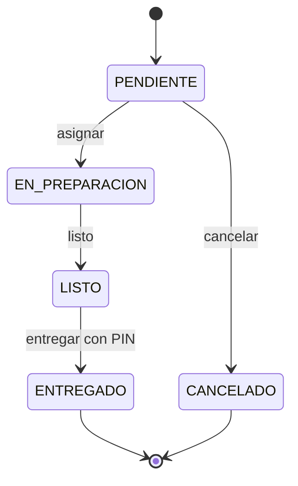
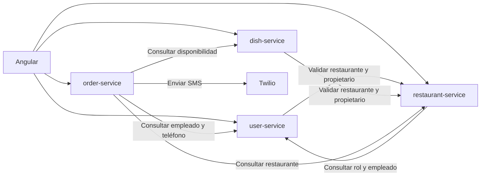

# Plaza de Comidas — Referencia de API REST

[Volver al README general](../README.md) · [Arquitectura](ARQUITECTURA.md) · [Base de datos](BASE-DE-DATOS.md)

## 1. Propósito y alcance

Referencia de los 31 endpoints de negocio identificados en los controladores Java de los cuatro microservicios. Las rutas y permisos se contrastaron con las copias disponibles de `SecurityConfig` y los DTO de entrada. Swagger/OpenAPI de la aplicación ejecutada es la referencia para los esquemas completos de respuesta y cualquier cambio posterior.

## 2. Servicios y documentación interactiva

| Servicio | URL base | Swagger | OpenAPI JSON |
|---|---|---|---|
| user-service | `http://localhost:8081` | [Swagger](http://localhost:8081/swagger-ui/index.html) | [JSON](http://localhost:8081/v3/api-docs) |
| restaurant-service | `http://localhost:8082` | [Swagger](http://localhost:8082/swagger-ui/index.html) | [JSON](http://localhost:8082/v3/api-docs) |
| dish-service | `http://localhost:8083` | [Swagger](http://localhost:8083/swagger-ui/index.html) | [JSON](http://localhost:8083/v3/api-docs) |
| order-service | `http://localhost:8084` | [Swagger](http://localhost:8084/swagger-ui/index.html) | [JSON](http://localhost:8084/v3/api-docs) |

Iniciar desde la raíz del frontend con PowerShell 7.5 o superior:

```powershell
.\scripts\iniciar-proyecto.ps1
```

Las rutas de negocio utilizan el prefijo `/api/v1`. No existe un gateway en el procedimiento local documentado: se consume el puerto de cada servicio.

## 3. Autenticación y convenciones

Las solicitudes protegidas requieren `Authorization: Bearer <JWT>`. Para cuerpos JSON utilizar `Content-Type: application/json`. El token se obtiene mediante login; su vigencia configurada es de 3600 segundos. El identificador autenticado se obtiene del subject del JWT en las operaciones que lo requieren. El claim `rol` permite aplicar las autoridades `ROLE_` correspondientes. La autorización por rol no sustituye las comprobaciones de pertenencia al restaurante o pedido.

Los identificadores de los ejemplos son ilustrativos y deben sustituirse por recursos existentes. Las contraseñas y tokens son marcadores, no credenciales reales. No publicar tokens ni PIN en capturas o repositorios.

## 4. user-service — Puerto 8081

| Método | Ruta | Acceso | Operación |
|---|---|---|---|
| POST | `/api/v1/auth/login` | Público | Autenticar |
| POST | `/api/v1/clientes` | Público | Registrar cliente |
| POST | `/api/v1/propietarios` | ADMINISTRADOR | Crear propietario |
| GET | `/api/v1/propietarios` | ADMINISTRADOR | Listar propietarios |
| POST | `/api/v1/empleados` | PROPIETARIO | Crear empleado |
| GET | `/api/v1/empleados/mi-restaurante` | EMPLEADO | Consultar restaurante asociado |
| GET | `/api/v1/usuarios/{id}/rol` | Autenticado | Consultar rol |
| GET | `/api/v1/clientes/{clienteId}/telefono` | Token interno | Consultar teléfono |

### 4.1. Login

`POST /api/v1/auth/login`

```json
{"correo":"usuario@example.com","contrasena":"<CONTRASENA>"}
```

Respuesta 200: DTO `LoginResponse` con token, tipo Bearer y vigencia de 3600 segundos. Credenciales incorrectas: 401. Consultar Swagger para los nombres exactos de las propiedades de respuesta.

### 4.2. Registro de cliente

`POST /api/v1/clientes`

```json
{"nombre":"Ana","apellido":"Ejemplo","documentoDeIdentidad":"1000000001","celular":"3001234567","correo":"cliente@example.com","clave":"<CONTRASENA>"}
```

No requiere fecha de nacimiento. El celular colombiano puede utilizar formato nacional o prefijo +57, según la normalización implementada. Usar un teléfono propio autorizado para pruebas SMS.

### 4.3. Crear propietario

`POST /api/v1/propietarios`

```json
{"nombre":"Luis","apellido":"Ejemplo","documentoIdentidad":"1000000002","celular":"3001234567","fechaNacimiento":"1990-01-01","correo":"propietario@example.com","contrasena":"<CONTRASENA>"}
```

La fecha usa ISO `yyyy-MM-dd`. El propietario debe cumplir las validaciones de negocio, incluida mayoría de edad. El listado GET no requiere cuerpo.

### 4.4. Crear empleado

`POST /api/v1/empleados`

```json
{"nombre":"Maria","apellido":"Ejemplo","documentoIdentidad":"1000000003","celular":"3001234567","correo":"empleado@example.com","clave":"<CONTRASENA>","idRol":"EMPLEADO","restauranteId":1}
```

El propietario autenticado debe estar autorizado sobre el restaurante. Verificar el valor de `idRol` en el contrato y validaciones de la versión desplegada antes de enviar la solicitud. La consulta de restaurante del empleado usa su identidad autenticada, sin cuerpo.

### 4.5. Consultas internas

`GET /api/v1/usuarios/{id}/rol`: requiere JWT válido; en la configuración revisada no se limita a un rol específico. No debe interpretarse como una ruta exclusivamente interna protegida por token de servicio.

`GET /api/v1/clientes/{clienteId}/telefono`: utiliza `X-Internal-Service-Token`, no el Bearer como mecanismo de autorización de esta operación. El token configurado debe tener al menos 32 caracteres. Devuelve 200 con `telefono`, 403 si la credencial falta o no coincide, 404 si no existe el cliente, 400 o 409 según la validación. No consumir desde Angular ni exponer el token interno.

## 5. restaurant-service — Puerto 8082

| Método | Ruta | Acceso | Operación |
|---|---|---|---|
| POST | `/api/v1/restaurantes` | ADMINISTRADOR | Crear restaurante |
| GET | `/api/v1/restaurantes` | CLIENTE, ADMINISTRADOR | Listar restaurantes |
| GET | `/api/v1/restaurantes/mi-restaurante` | PROPIETARIO | Consultar restaurante propio |
| GET | `/api/v1/restaurantes/mi-restaurante-empleado` | EMPLEADO | Consultar restaurante asociado |
| GET | `/api/v1/restaurantes/propietarios-asignados` | ADMINISTRADOR | Listar identificadores de propietarios asignados |
| GET | `/api/v1/restaurantes/{id}` | Autenticado | Verificar existencia |
| GET | `/api/v1/restaurantes/{id}/propietarios/{usuarioId}` | Autenticado | Verificar propiedad |

### 5.1. Crear restaurante

```json
{"nombre":"Restaurante Ejemplo","nit":"900123456","direccion":"Calle de ejemplo 10","telefono":"3001234567","urlLogo":"https://example.com/logo.png","propietarioId":1}
```

Enviar mediante POST a `/api/v1/restaurantes`. Respuesta 201; posibles errores 400, 409 y 503, además de autenticación y autorización. El propietario debe existir y satisfacer las reglas de asignación.

### 5.2. Listado y consultas

`GET /api/v1/restaurantes?page=0&size=10`: parámetros opcionales, página inicial cero y tamaño predeterminado diez.

Las consultas `mi-restaurante`, `mi-restaurante-empleado` y `propietarios-asignados` no requieren cuerpo. Esta última devuelve una lista de identificadores.

La consulta de existencia devuelve 200 sin cuerpo o 404. La verificación de propiedad devuelve 200 con booleano. No confundir la verificación de existencia con un endpoint de detalle completo.

## 6. dish-service — Puerto 8083

| Método | Ruta | Acceso | Operación |
|---|---|---|---|
| POST | `/api/v1/platos` | PROPIETARIO | Crear plato |
| PATCH | `/api/v1/platos/{id}` | PROPIETARIO | Modificar precio y descripción |
| PATCH | `/api/v1/platos/{id}/habilitar` | PROPIETARIO | Habilitar |
| PATCH | `/api/v1/platos/{id}/deshabilitar` | PROPIETARIO | Deshabilitar |
| DELETE | `/api/v1/platos/{id}` | PROPIETARIO | Eliminación lógica |
| GET | `/api/v1/restaurantes/{restauranteId}/platos` | CLIENTE, PROPIETARIO | Listar catálogo |
| GET | `/api/v1/platos/{platoId}/disponibilidad` | CLIENTE | Verificar disponibilidad |

### 6.1. Crear plato

```json
{"nombre":"Hamburguesa","precio":25000,"descripcion":"Hamburguesa artesanal","urlImagen":"https://example.com/plato.jpg","categoria":"Hamburguesas","restauranteId":1}
```

POST `/api/v1/platos`. Precio entero. Respuesta 201 con identificador y mensaje. La categoría debe cumplir las reglas de la versión desplegada. Errores documentados: 400, 401, 403, 404, 503.

### 6.2. Modificar plato

PATCH `/api/v1/platos/1`:

```json
{"precio":28000,"descripcion":"Hamburguesa artesanal con queso"}
```

Solo se admiten `precio` y `descripcion`; no se permite cambiar nombre, categoría, imagen, restaurante ni estado mediante esta ruta. Respuesta 200. Las operaciones de habilitación, deshabilitación y eliminación lógica utilizan rutas separadas sin cuerpo y requieren propiedad del restaurante.

### 6.3. Consultar catálogo y disponibilidad

`GET /api/v1/restaurantes/1/platos?page=0&size=10`: admite además `categoria` opcional. El backend aplica las reglas de visibilidad correspondientes al rol.

`GET /api/v1/platos/1/disponibilidad?restauranteId=1`: requiere ambos identificadores positivos. Devuelve 200 con booleano; comprueba que el plato pertenece al restaurante, está activo y no está eliminado. Identificadores inválidos: 400.

## 7. order-service — Puerto 8084

| Método | Ruta | Acceso | Operación |
|---|---|---|---|
| POST | `/api/v1/pedidos` | CLIENTE | Crear pedido |
| GET | `/api/v1/pedidos/mi-pedido-activo` | CLIENTE | Consultar pedido activo |
| GET | `/api/v1/pedidos` | EMPLEADO | Listar pedidos por estado |
| PATCH | `/api/v1/pedidos/{pedidoId}/asignar` | EMPLEADO | Asignar e iniciar preparación |
| PATCH | `/api/v1/pedidos/{pedidoId}/listo` | EMPLEADO | Marcar listo |
| PATCH | `/api/v1/pedidos/{pedidoId}/entregar` | EMPLEADO | Confirmar entrega con PIN |
| PATCH | `/api/v1/pedidos/{pedidoId}/cancelar` | CLIENTE | Cancelar pedido pendiente |
| GET | `/api/v1/pedidos/{pedidoId}/trazabilidad` | CLIENTE | Consultar historial propio |
| GET | `/api/v1/restaurantes/{restauranteId}/pedidos/eficiencia` | PROPIETARIO | Consultar tiempos de pedidos |
| GET | `/api/v1/restaurantes/{restauranteId}/empleados/ranking` | PROPIETARIO | Consultar ranking de empleados |

### 7.1. Crear pedido

```json
{"restauranteId":1,"platos":[{"platoId":1,"cantidad":2}]}
```

POST `/api/v1/pedidos`. Restaurante y platos con identificadores positivos, lista no vacía y cantidades positivas. El cliente se obtiene del JWT. Se valida disponibilidad y pertenencia de los platos; no se permite otro pedido activo simultáneo. Respuesta 201.

### 7.2. Pedido activo

GET `/api/v1/pedidos/mi-pedido-activo`: 200 si existe pedido activo; 204 sin cuerpo si no existe. El frontend consulta periódicamente cada cinco segundos durante el seguimiento implementado. Un 204 no es un error ni debe interpretarse como un objeto JSON vacío.

### 7.3. Gestión por empleado

GET `/api/v1/pedidos?estado=PENDIENTE&page=0&size=10`: `estado` obligatorio, `page` y `size` opcionales.

PATCH `/api/v1/pedidos/1/asignar`: asigna el pedido y avanza a preparación. PATCH `/api/v1/pedidos/1/listo`: marca listo y activa el flujo de notificación correspondiente. Ambas operaciones sin cuerpo. El empleado debe cumplir las reglas de autorización y estado.

PATCH `/api/v1/pedidos/1/entregar`:

```json
{"pin":"123456"}
```

El PIN es ilustrativo; utilizar el recibido por el cliente. Debe ser una cadena de seis dígitos. Respuesta 200 con mensaje; PIN incorrecto o inválido: 400; pedido ajeno: 403; inexistente: 404; estado incompatible: 409; dependencia no disponible: 503.

### 7.4. Cancelación, trazabilidad y eficiencia

PATCH `/api/v1/pedidos/1/cancelar`: sin cuerpo, sujeto a propiedad del pedido y estado pendiente.

GET `/api/v1/pedidos/1/trazabilidad`: historial del pedido del cliente autenticado.

GET `/api/v1/restaurantes/1/pedidos/eficiencia` y GET `/api/v1/restaurantes/1/empleados/ranking`: requieren rol PROPIETARIO y autorización sobre el restaurante. Consultar los DTO de respuesta en Swagger para los campos y unidades de tiempo exactos.



## 8. Comunicación entre servicios



Vista conceptual de dependencias. Las llamadas protegidas utilizan el JWT correspondiente cuando aplica. La consulta del teléfono utiliza una credencial interna compartida. Twilio es una integración de salida, no un endpoint de negocio expuesto por el frontend. Los servicios no deben consultar directamente las tablas de otros dominios.

## 9. Códigos HTTP

| Código | Interpretación |
|---|---|
| 200 | Operación exitosa |
| 201 | Creación exitosa |
| 204 | Sin contenido; pedido activo inexistente |
| 400 | Datos inválidos o PIN incorrecto |
| 401 | Autenticación ausente o inválida |
| 403 | Rol, pertenencia o credencial interna no autorizados |
| 404 | Recurso no encontrado |
| 409 | Conflicto de estado o regla de negocio |
| 500 | Error interno no controlado |
| 503 | Dependencia no disponible cuando se contempla este manejo |

No todos los endpoints devuelven todos estos códigos. Los controladores pueden devolver mensajes con `mensaje`, DTO específicos, booleanos o respuestas sin cuerpo. No asumir un esquema universal de errores.

## 10. Ejecución de pruebas manuales

1. Iniciar el proyecto y abrir Swagger de user-service.
2. Autenticarse con una cuenta válida y copiar el JWT.
3. En Swagger del servicio correspondiente, utilizar Authorize cuando esté disponible o enviar el encabezado Bearer con un cliente HTTP.
4. Crear propietario y restaurante como administrador; crear plato y empleado como propietario.
5. Registrar cliente y crear pedido con su token.
6. Con el token del empleado, listar, asignar y marcar listo.
7. Confirmar recepción del SMS y entregar con el PIN real. Probar primero un PIN incorrecto.
8. Consultar trazabilidad con el token del cliente y eficiencia con el token del propietario.
9. Verificar rechazo de un rol no autorizado y de un segundo pedido activo.

Ejemplo PowerShell para una consulta de solo lectura:

```powershell
$token = Read-Host 'JWT del cliente' -MaskInput
$headers = @{ Authorization = "Bearer $token" }
Invoke-RestMethod -Uri 'http://localhost:8082/api/v1/restaurantes?page=0&size=10' -Headers $headers
Remove-Variable token, headers
```

Para comprobar el estado HTTP sin interpretar el cuerpo:

```powershell
$token = Read-Host 'JWT del cliente' -MaskInput
$r = Invoke-WebRequest -Uri 'http://localhost:8084/api/v1/pedidos/mi-pedido-activo' -Headers @{ Authorization = "Bearer $token" }
$r.StatusCode
Remove-Variable token, r
```

## 11. Verificación y mantenimiento del contrato

Los contratos completos pueden descargarse con el sistema iniciado:

```powershell
foreach ($puerto in 8081,8082,8083,8084) {
    Invoke-WebRequest "http://localhost:$puerto/v3/api-docs" -OutFile "openapi-$puerto.json"
}
```

Revisar los JSON antes de publicarlos. Ante cambios de rutas, DTO o permisos, actualizar este documento y las pruebas correspondientes. No confundir patrones permitidos por Spring Security con endpoints efectivamente implementados por un controlador.

**Base de revisión:** copias `user-service(8).zip`, `restaurant-service(5).zip`, `dish-service(2).zip` y `order-service(6).zip`, documentación individual y README general. No se ejecutaron nuevas solicitudes HTTP ni se verificó la última versión local del código al redactar este documento. Los ejemplos no constituyen datos precargados. La auditoría integral de seguridad y la validación desde una instalación limpia quedan fuera de esta revisión.
