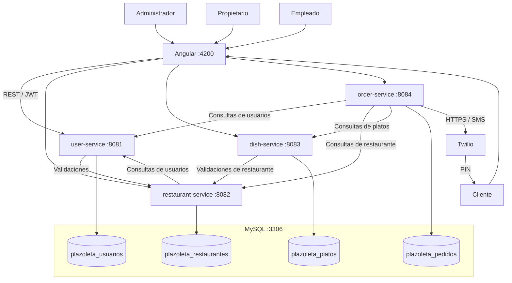
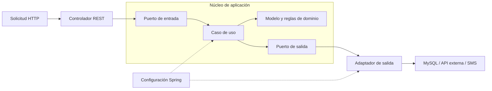
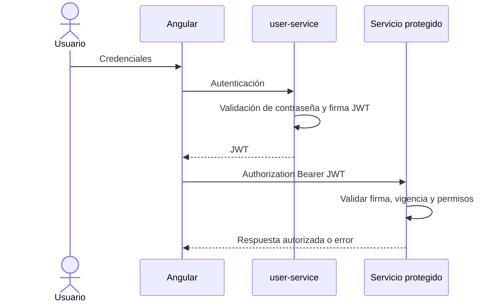
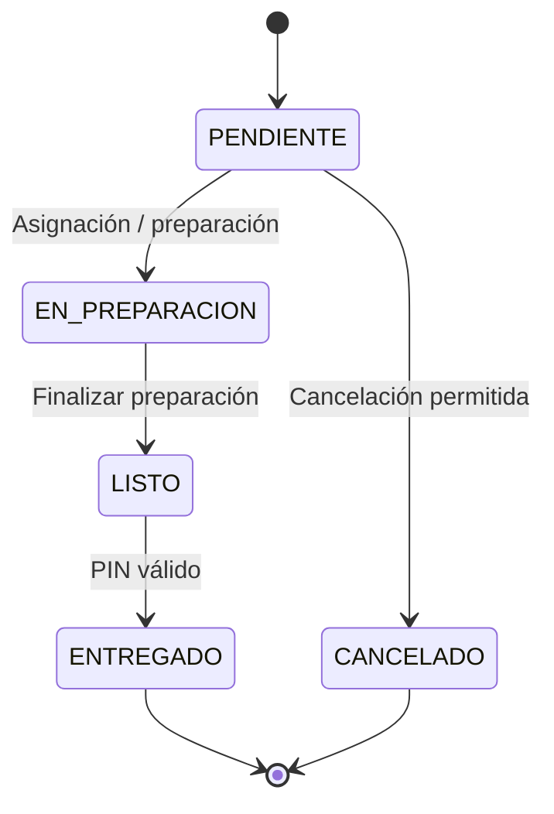
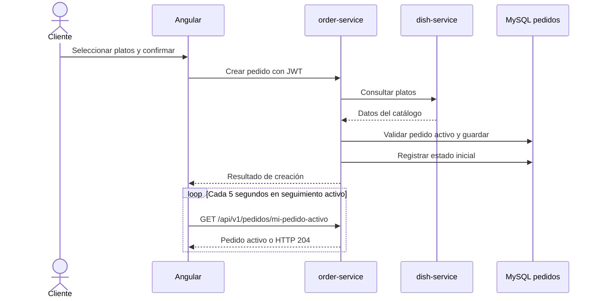
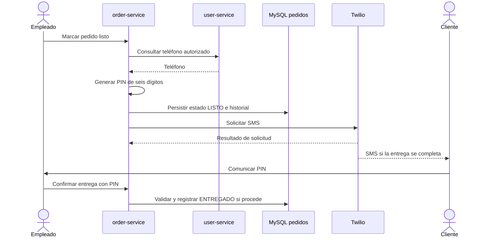
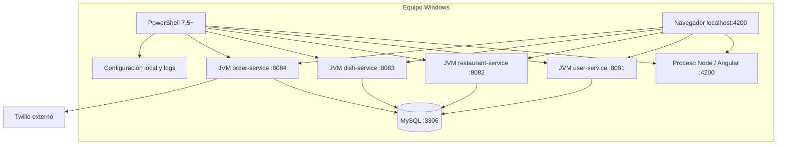

# Arquitectura del sistema — Plaza de Comidas

> Documento técnico complementario al [README general](../README.md). Describe la arquitectura implementada para el entorno académico local, no una arquitectura de producción certificada.

## 1. Propósito y alcance

Plaza de Comidas permite administrar usuarios, restaurantes, platos y pedidos, desde la creación de un establecimiento hasta la entrega de un pedido mediante PIN. La solución combina cuatro microservicios Java 21 con Spring Boot, una aplicación Angular 21 y persistencia MySQL. La separación de dominios y la arquitectura hexagonal buscan facilitar el mantenimiento, las pruebas y la evolución independiente de los componentes.

## 2. Vista general de componentes



Las flechas entre servicios representan dependencias de consulta, no una cadena obligatoria para todas las solicitudes. Angular consume directamente las API; no se representa un API Gateway porque no forma parte del despliegue documentado.

## 3. Límites de responsabilidad

| Componente | Responsabilidad | Repositorio |
|---|---|---|
| user-service | Usuarios, credenciales, roles, autenticación, propietarios, empleados y clientes | [Código](https://github.com/khaos80/user-service) |
| restaurant-service | Restaurantes y relaciones de propiedad | [Código](https://github.com/khaos80/restaurant-service) |
| dish-service | Catálogo, precios, categorías y disponibilidad | [Código](https://github.com/khaos80/dish-service) |
| order-service | Pedidos, asignación, estados, PIN, trazabilidad e indicadores | [Código](https://github.com/khaos80/order-service) |
| plazoleta-frontend | Interfaz, navegación, formularios y consumo de API | [Código](https://github.com/khaos80/plazoleta-frontend) |

Cada servicio backend dispone de su propio proyecto Maven, configuración Spring Boot, casos de uso, adaptadores, pruebas y JAR ejecutable. La independencia de compilación no implica independencia funcional: determinadas operaciones requieren que otros servicios estén disponibles.

## 4. Arquitectura hexagonal

El patrón Ports and Adapters separa las reglas de negocio de los mecanismos de entrada y salida. Los casos de uso implementan puertos de entrada y utilizan abstracciones de salida; la infraestructura proporciona las implementaciones concretas.



El diagrama muestra el flujo de ejecución. En términos de dependencias de código, el adaptador implementa la interfaz del puerto de salida, no al contrario. La configuración Spring conecta las implementaciones con los casos de uso mediante inyección de dependencias.

### 4.1. Capas

| Capa | Elementos | Función |
|---|---|---|
| Dominio | Modelos, estados, excepciones | Representar conceptos y restricciones del negocio |
| Aplicación | Casos de uso y puertos | Coordinar operaciones y depender de contratos |
| Infraestructura de entrada | Controladores, DTO, seguridad HTTP | Recibir solicitudes y traducir respuestas |
| Infraestructura de salida | Adaptadores JPA, clientes HTTP, JWT y SMS | Implementar acceso a recursos externos |
| Configuración | Beans y configuración Spring | Componer los componentes |

### 4.2. Organización de paquetes

```text
src/main/java/com/plazoleta/<servicio>/
├── domain/
├── application/
│   ├── port/ o ports/
│   │   ├── in/
│   │   └── out/
│   └── usecase/
└── infrastructure/
    ├── config/
    ├── input/
    └── output/
```

En las copias de código revisadas, user-service y restaurant-service utilizan `application/port`, mientras dish-service y order-service utilizan `application/ports`. La diferencia nominal no altera el patrón. Los subpaquetes específicos varían por servicio. Los mensajes de error de casos de uso se centralizan en `MensajesError`.

### 4.3. Ejemplos concretos de implementación

| Servicio | Puerto de salida | Adaptador |
|---|---|---|
| user-service | UsuarioRepositoryPort | UsuarioPersistenceAdapter |
| user-service | PasswordEncoderPort | BCryptPasswordAdapter |
| user-service | TokenPort | JwtTokenAdapter |
| restaurant-service | RestauranteRepositoryPort | RestaurantePersistenceAdapter |
| dish-service | PlatoPersistencePort | PlatoPersistenceAdapter |
| dish-service | RestaurantePort | RestauranteHttpAdapter |
| order-service | PedidoPersistencePort | PedidoPersistenceAdapter |
| order-service | EnviarSmsPort | SmsSimuladoAdapter / TwilioSmsAdapter |

La sustitución del proveedor SMS ilustra la inversión de dependencias: la lógica de aplicación puede operar con un contrato sin acoplarse a la API concreta de Twilio.

## 5. Comunicación distribuida

La comunicación utiliza HTTP/REST síncrono. Los clientes de infraestructura consultan otros dominios cuando necesitan verificar información que no administran localmente.

| Origen | Destino | Motivo |
|---|---|---|
| Usuarios | Restaurantes | Validaciones relacionadas con establecimientos |
| Restaurantes | Usuarios | Consultas de propietarios y empleados |
| Platos | Restaurantes | Validación de establecimiento y propiedad |
| Pedidos | Usuarios | Información de empleados y teléfono del cliente |
| Pedidos | Restaurantes | Validaciones de propiedad |
| Pedidos | Platos | Información necesaria para registrar pedidos |

La indisponibilidad de un servicio remoto puede impedir una operación dependiente. No se presupone descubrimiento dinámico de servicios, mensajería asíncrona, circuit breakers ni transacciones distribuidas. Swagger/OpenAPI permite consultar los contratos efectivos de cada API.

## 6. Seguridad y límites de confianza



- user-service emite JWT firmados mediante RS256; los servicios consumidores verifican la firma con la clave pública correspondiente.
- Las claves RSA se generan localmente: privada PKCS#8 y pública X.509, codificadas en Base64. Base64 no es cifrado.
- Las contraseñas de usuarios se protegen mediante BCrypt. La vigencia JWT documentada es de 60 minutos.
- Los roles ADMINISTRADOR, PROPIETARIO, EMPLEADO y CLIENTE delimitan las operaciones. La interfaz no sustituye las comprobaciones de autorización del backend.
- La consulta interna del teléfono del cliente utiliza un token de servicio; no debe exponerse al navegador.
- El origen de desarrollo del frontend es `http://localhost:4200`. CORS no sustituye la autenticación.

La configuración local no equivale a una auditoría integral. El transporte HTTP local, la gestión de secretos y la exposición de Swagger deben revisarse antes de un despliegue público.

## 7. Persistencia y propiedad de datos

| Servicio | Esquema MySQL | Tablas |
|---|---|---|
| user-service | plazoleta_usuarios | usuarios |
| restaurant-service | plazoleta_restaurantes | restaurantes |
| dish-service | plazoleta_platos | platos |
| order-service | plazoleta_pedidos | pedidos, detalles_pedido, pedido_estado_historial, bloqueos_cliente |

Los esquemas se encuentran en una misma instancia MySQL local. La separación es lógica, no física. Las referencias entre dominios se validan mediante sus API; la relación física documentada entre `detalles_pedido.pedido_id` y `pedidos.id` pertenece al mismo esquema.

La persistencia utiliza Spring Data JPA e Hibernate. Los adaptadores traducen modelos de dominio a entidades de persistencia. El bloqueo de cliente y la consulta de estados activos participan en el control de pedidos simultáneos. Las garantías de concurrencia dependen de los límites transaccionales y deben comprobarse con MySQL, no solamente H2.

El usuario de aplicación local comparte permisos sobre los cuatro esquemas por simplicidad operativa. Para producción convendría separar credenciales y privilegios por servicio. Los scripts SQL de `database/` aprovisionan los esquemas sin eliminar registros existentes; no sustituyen una estrategia de migraciones versionadas.

## 8. Flujo de negocio de pedidos



Los estados activos son PENDIENTE, EN_PREPARACION y LISTO. El backend controla la pertenencia al restaurante, la asignación y las transiciones permitidas. El historial registra cambios de estado y sus tiempos para seguimiento e indicadores de eficiencia. El diagrama no sustituye las precondiciones de cada caso de uso.

### 8.1. Creación y seguimiento



La secuencia es conceptual: omite validaciones y detalles de transacción. Angular consulta el estado mediante polling, no mediante WebSockets. El historial persistido constituye la fuente del seguimiento visual.

## 9. Integración SMS y entrega



`MarcarPedidoListoUseCase` utiliza `SecureRandom` para generar el PIN. La selección del proveedor se configura mediante `SMS_PROVEEDOR`: simulado para pruebas o Twilio para envío real. El adaptador Twilio utiliza HTTP con autenticación de cuenta. Los teléfonos colombianos se normalizan a E.164, aceptando diez dígitos iniciados en 3 o su variante con +57.

Según el README general, el estado LISTO se conserva si falla el envío. La aceptación del mensaje por Twilio no garantiza recepción en el dispositivo. No se afirma que exista una cola persistente, reintentos automáticos o confirmación de entrega mediante webhook. La entrega con PIN incorrecto debe rechazarse.

## 10. Arquitectura frontend

Angular 21 utiliza TypeScript y componentes standalone. Las interfaces se organizan según el rol y consumen las API REST. Los formularios capturan datos, los servicios de comunicación encapsulan solicitudes HTTP y la interfaz representa resultados y errores.

| Rol | Vista funcional |
|---|---|
| Administrador | Creación y consulta de propietarios y restaurantes |
| Propietario | Catálogo, empleados e indicadores operativos |
| Empleado | Gestión de pedidos y confirmación de entrega |
| Cliente | Restaurantes, menú, carrito, pedidos y seguimiento |

El backend mantiene la autoridad sobre las reglas de negocio. El estado visual del carrito o de los botones no constituye una garantía de autorización ni de integridad.

## 11. Estrategia de pruebas

Las pruebas se organizan bajo `src/test/java/com/plazoleta/<servicio>/tests/`, con subpaquetes `adapter`, `controller`, `integration` y `usecase`. La prueba de arranque puede ubicarse en el paquete raíz del servicio.

| Nivel | Propósito |
|---|---|
| Casos de uso | Validar reglas de negocio mediante dependencias aisladas |
| Controladores | Validar contratos HTTP, seguridad y respuestas |
| Adaptadores | Comprobar persistencia y traducción de contratos externos |
| Integración | Comprobar colaboración entre componentes |

Los perfiles de prueba utilizan H2, deshabilitan el bootstrap del administrador y evitan SMS reales mediante el proveedor simulado en order-service. H2 no reemplaza las pruebas de compatibilidad, concurrencia y aprovisionamiento sobre MySQL.

Resultados históricos confirmados: user-service 137, restaurant-service 176, dish-service 114 y order-service 266; total **693 pruebas superadas**. No se ejecutaron nuevamente al elaborar este documento.

## 12. Vista de despliegue local



El iniciador comprueba requisitos, clona o verifica repositorios, configura el entorno, MySQL y Twilio, prepara el administrador, compila los JAR e inicia los procesos. Angular escucha en IPv4 y se accede por localhost. La comprobación TCP de los servicios y HTTP 200 del frontend verifica disponibilidad inicial, no todas las operaciones de negocio.

El script de detención identifica los procesos registrados por PID y hora de inicio y los finaliza en orden inverso. No detiene MySQL. La detención es forzada; debe realizarse sin operaciones en curso.

La configuración y los logs se guardan en `%LOCALAPPDATA%/Plazoleta`, fuera de Git. El JSON de entorno contiene secretos legibles; DPAPI protege las contraseñas configuradas de Twilio y administrador según el procedimiento documentado. El remitente Twilio debe estar autorizado por la cuenta utilizada.

## 13. Decisiones y compromisos arquitectónicos

| Decisión | Beneficio | Compromiso |
|---|---|---|
| Cuatro microservicios | Límites funcionales y compilación independiente | Más procesos y dependencias de red |
| Arquitectura hexagonal | Sustitución de adaptadores y pruebas aisladas | Mayor número de contratos y clases |
| REST síncrono | Integración directa y fácil diagnóstico | Acoplamiento temporal a servicios remotos |
| Esquemas separados en MySQL | Propiedad lógica de datos | Instancia compartida como punto común de fallo |
| JWT asimétrico | Verificación distribuida | Gestión y rotación de claves |
| Polling de pedidos | Implementación sencilla | Consultas periódicas y latencia de actualización |
| Puerto SMS intercambiable | Pruebas sin costes de mensajería | Dependencia externa en envío real |
| PowerShell sin Docker | Instalación local automatizada | Dependencia de Windows y herramientas instaladas |

## 14. Limitaciones y evolución

El alcance validado es académico y local. Como mejoras futuras, no como funcionalidades implementadas, se contemplan:

- TLS, gestión centralizada de secretos y rotación de claves.
- Credenciales de base de datos por microservicio y migraciones versionadas.
- Health checks funcionales, métricas y trazabilidad distribuida.
- Estrategia persistente de notificaciones, reintentos e idempotencia.
- Pruebas de carga, concurrencia y recuperación ante fallos.
- Apagado ordenado, automatización CI/CD y despliegue reproducible.

## 15. Evidencia y estado de validación

Este documento se apoya en el README general, las copias disponibles de los cuatro proyectos backend y las validaciones realizadas durante el desarrollo. Los diagramas son vistas conceptuales de la implementación, no diagramas generados automáticamente desde el código.

El inicio y la detención automáticos fueron confirmados en la instalación existente. También se reportaron pruebas exitosas de SMS real y entrega con PIN. La instalación integral desde un clon limpio, el aprovisionamiento MySQL nuevo y el bootstrap de un administrador nuevo permanecen pendientes de validación. No se realizó una nueva auditoría integral de seguridad ni se contrastó cada archivo con la última versión local o remota.

Para instalación y ejecución, consultar el [README general](../README.md). Para contratos efectivos, utilizar Swagger de cada servicio y sus repositorios de código.
