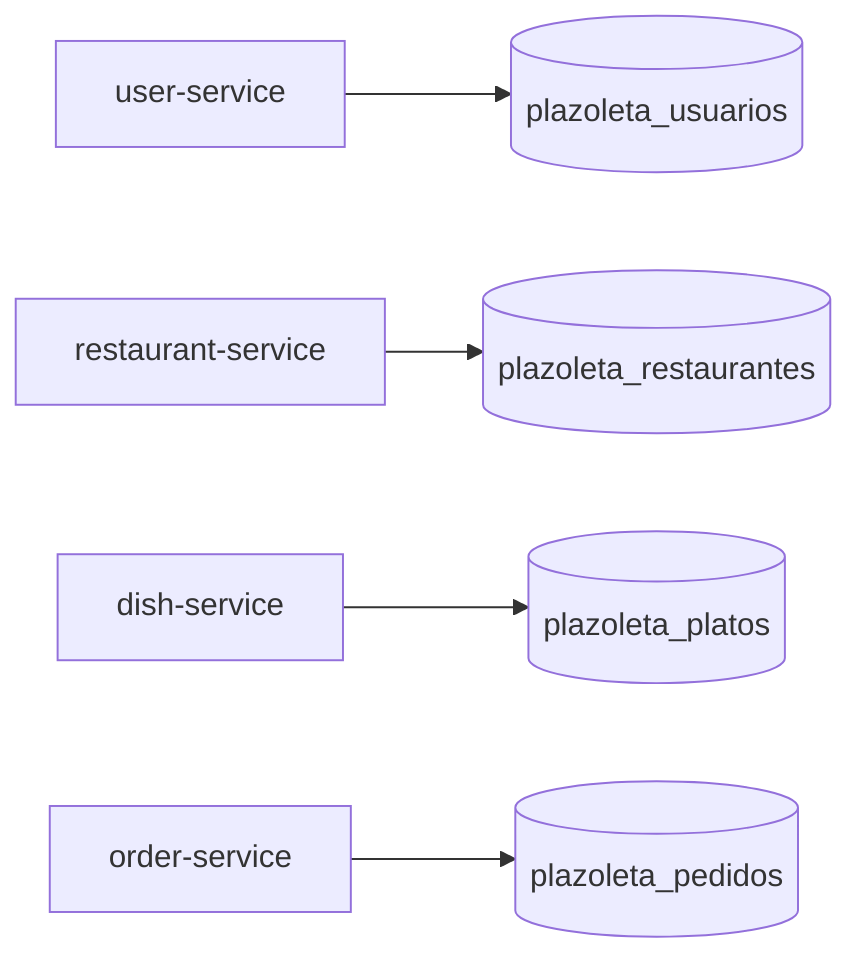
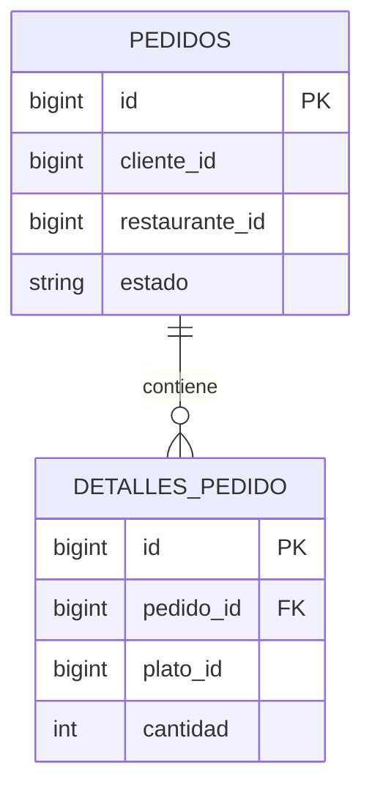
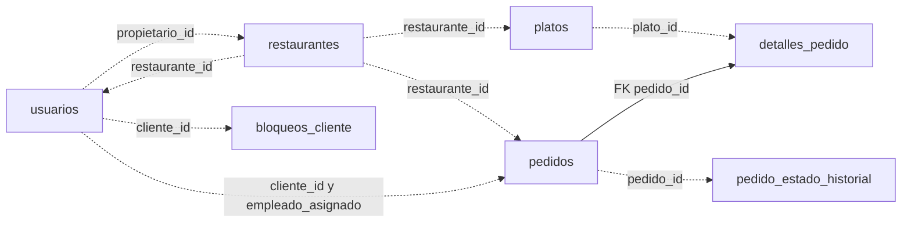

# Base de datos — Plaza de Comidas

[Volver al README general](../README.md) · [Arquitectura](ARQUITECTURA.md)

## 1. Propósito y alcance

La persistencia operacional utiliza MySQL, InnoDB y Spring Data JPA/Hibernate. Cada microservicio posee un esquema independiente en una misma instancia local de MySQL (puerto 3306). La separación es lógica, no implica cuatro servidores físicos. Este documento describe el DDL de los cinco scripts SQL entregados; Hibernate puede introducir diferencias en una instalación existente. No constituye una extracción nueva de la base de datos activa.

## 2. Distribución de esquemas

| Servicio | Esquema | Tablas |
|---|---|---|
| user-service | `plazoleta_usuarios` | `usuarios` |
| restaurant-service | `plazoleta_restaurantes` | `restaurantes` |
| dish-service | `plazoleta_platos` | `platos` |
| order-service | `plazoleta_pedidos` | `pedidos`, `detalles_pedido`, `pedido_estado_historial`, `bloqueos_cliente` |



Los identificadores de otros dominios se conservan como valores escalares. La existencia y autorización de recursos externos se comprueba mediante la lógica de aplicación y las API REST, no mediante claves foráneas entre esquemas.

## 3. Diccionario de datos

Los tipos, longitudes y restricciones siguientes se extraen del DDL distribuido. PK = clave primaria; FK = clave foránea; UQ = unicidad. La ausencia de NOT NULL permite NULL. Las reglas de negocio adicionales no deben confundirse con restricciones SQL.


### `plazoleta_usuarios.usuarios`

Identidad, credenciales y rol. La contraseña debe contener el hash generado por el backend, no la contraseña original. La fecha de nacimiento y la asociación a restaurante admiten NULL.

| Columna | Tipo | Restricciones |
|---|---|---|

| `id` | `BIGINT` | NOT NULL AUTO_INCREMENT PRIMARY KEY |

| `nombre` | `VARCHAR(100)` | NOT NULL |

| `apellido` | `VARCHAR(100)` | NOT NULL |

| `documento_identidad` | `VARCHAR(10)` | NOT NULL UNIQUE |

| `celular` | `VARCHAR(13)` | NOT NULL |

| `fecha_nacimiento` | `DATE` | NULL permitido |

| `correo` | `VARCHAR(254)` | NOT NULL UNIQUE |

| `contrasena` | `VARCHAR(255)` | NOT NULL |

| `rol` | `ENUM('ADMINISTRADOR','PROPIETARIO','EMPLEADO','CLIENTE')` | NOT NULL |

| `restaurante_id` | `BIGINT` | NULL permitido |


### `plazoleta_restaurantes.restaurantes`

Información del establecimiento y su propietario. El NIT y el propietario son únicos según el DDL: un propietario puede estar asociado como máximo a un restaurante.

| Columna | Tipo | Restricciones |
|---|---|---|

| `id` | `BIGINT` | NOT NULL AUTO_INCREMENT PRIMARY KEY |

| `nombre` | `VARCHAR(255)` | NOT NULL |

| `nit` | `VARCHAR(255)` | NOT NULL |

| `direccion` | `VARCHAR(255)` | NOT NULL |

| `telefono` | `VARCHAR(13)` | NOT NULL |

| `url_logo` | `VARCHAR(255)` | NOT NULL |

| `propietario_id` | `BIGINT` | NOT NULL |


Restricciones e índices adicionales:

- `CONSTRAINT uk_restaurantes_nit UNIQUE (nit)`
- `CONSTRAINT uk_restaurantes_propietario UNIQUE (propietario_id)`


### `plazoleta_platos.platos`

Catálogo de platos. El precio se almacena como entero; activo y eliminado son indicadores BIT. La positividad del precio se controla en la aplicación, no mediante CHECK en este DDL.

| Columna | Tipo | Restricciones |
|---|---|---|

| `id` | `BIGINT` | NOT NULL AUTO_INCREMENT PRIMARY KEY |

| `nombre` | `VARCHAR(255)` | NOT NULL |

| `precio` | `INT` | NOT NULL |

| `descripcion` | `VARCHAR(1000)` | NOT NULL |

| `url_imagen` | `VARCHAR(255)` | NOT NULL |

| `categoria` | `VARCHAR(255)` | NOT NULL |

| `restaurante_id` | `BIGINT` | NOT NULL |

| `activo` | `BIT(1)` | NOT NULL |

| `eliminado` | `BIT(1)` | NOT NULL |


### `plazoleta_pedidos.pedidos`

Cabecera del pedido, cliente, restaurante, estado, empleado y PIN. El empleado y PIN pueden estar ausentes. El índice cliente/estado facilita consultas de pedidos activos, pero no impone unicidad.

| Columna | Tipo | Restricciones |
|---|---|---|

| `id` | `BIGINT` | NOT NULL AUTO_INCREMENT PRIMARY KEY |

| `cliente_id` | `BIGINT` | NOT NULL |

| `restaurante_id` | `BIGINT` | NOT NULL |

| `estado` | `ENUM('PENDIENTE','EN_PREPARACION','LISTO','ENTREGADO','CANCELADO')` | NOT NULL |

| `empleado_asignado` | `BIGINT` | NULL permitido |

| `pin_seguridad` | `VARCHAR(6)` | NULL permitido |


Restricciones e índices adicionales:

- `INDEX idx_pedido_cliente_estado (cliente_id, estado)`


### `plazoleta_pedidos.detalles_pedido`

Líneas del pedido. La combinación pedido/plato es única; la FK exige que exista el pedido. No hay FK hacia platos ni CHECK de cantidad en el DDL.

| Columna | Tipo | Restricciones |
|---|---|---|

| `id` | `BIGINT` | NOT NULL AUTO_INCREMENT PRIMARY KEY |

| `pedido_id` | `BIGINT` | NOT NULL |

| `plato_id` | `BIGINT` | NOT NULL |

| `cantidad` | `INT` | NOT NULL |


Restricciones e índices adicionales:

- `CONSTRAINT uk_pedido_plato UNIQUE (pedido_id, plato_id)`
- `CONSTRAINT fk_detalles_pedido FOREIGN KEY (pedido_id) REFERENCES pedidos(id)`


### `plazoleta_pedidos.pedido_estado_historial`

Eventos de cambio de estado con precisión temporal de microsegundos. El estado anterior admite NULL para representar el evento inicial. El identificador del pedido está indexado, pero no tiene FK declarada.

| Columna | Tipo | Restricciones |
|---|---|---|

| `id` | `BIGINT` | NOT NULL AUTO_INCREMENT PRIMARY KEY |

| `pedido_id` | `BIGINT` | NOT NULL |

| `estado_anterior` | `ENUM('PENDIENTE','EN_PREPARACION','LISTO','ENTREGADO','CANCELADO')` | NULL permitido |

| `estado_nuevo` | `ENUM('PENDIENTE','EN_PREPARACION','LISTO','ENTREGADO','CANCELADO')` | NOT NULL |

| `fecha_cambio` | `DATETIME(6)` | NOT NULL |


Restricciones e índices adicionales:

- `INDEX idx_historial_pedido_fecha (pedido_id, fecha_cambio)`


### `plazoleta_pedidos.bloqueos_cliente`

Registro auxiliar identificado por cliente para coordinar la concurrencia en la creación de pedidos. La PK impide duplicar la fila de bloqueo; por sí sola no garantiza la regla de pedido activo.

| Columna | Tipo | Restricciones |
|---|---|---|

| `cliente_id` | `BIGINT` | NOT NULL PRIMARY KEY |


## 4. Modelo entidad-relación

### 4.1. Relación física declarada



La FK `fk_detalles_pedido` no declara eliminación en cascada. La cardinalidad física permite cero o más detalles; la aplicación debe validar que un pedido tenga contenido válido.

### 4.2. Relaciones lógicas (no son FK SQL)



Las flechas discontinuas representan referencias de negocio, no restricciones físicas. El historial pertenece al pedido por su identificador; su integridad depende de las operaciones del servicio. No se deben agregar FK entre dominios sin revisar el diseño y las migraciones.

## 5. Integridad y concurrencia

- Las PK identifican registros de forma única. Todas son autoincrementales salvo `bloqueos_cliente.cliente_id`.
- La unicidad del documento y correo protege la identidad de usuarios; NIT y propietario protegen la asociación de restaurantes.
- La unicidad compuesta de detalles evita repetir un plato en un mismo pedido.
- El bloqueo por cliente y las validaciones transaccionales de order-service están destinados a evitar pedidos activos simultáneos. No existe una restricción UNIQUE sobre cliente y estado que implemente esa regla.
- El ciclo de estados es PENDIENTE → EN_PREPARACION → LISTO → ENTREGADO, con cancelación según reglas de negocio. El ENUM limita valores, no transiciones.
- No hay restricciones CHECK explícitas para precio o cantidad en los scripts; el backend debe validar esos valores.
- Los índices `idx_pedido_cliente_estado` e `idx_historial_pedido_fecha` apoyan consultas por cliente/estado y por pedido/fecha, respectivamente.

## 6. Aprovisionamiento automatizado

Desde la raíz de `plazoleta-frontend`, en Windows PowerShell 7.5 o superior:

```powershell
.\scripts\configurar-entorno.ps1
.\scripts\configurar-mysql.ps1
```

También se ejecutan desde `iniciar-proyecto.ps1`. El configurador localiza MySQL, comprueba el puerto 3306 y valida el acceso a las siete tablas. Si la instalación existente funciona, se reutiliza sin solicitar root. Para crear recursos faltantes se necesita una cuenta administrativa autorizada. La contraseña de una cuenta existente no se debe reemplazar automáticamente.

| Orden | Archivo | Responsabilidad |
|---|---|---|


| 1 | [01-crear-bases-datos.sql](../database/01-crear-bases-datos.sql) | Crear cuatro esquemas utf8mb4 |

| 2 | [02-crear-tabla-usuarios.sql](../database/02-crear-tabla-usuarios.sql) | Crear usuarios |

| 3 | [03-crear-tabla-restaurantes.sql](../database/03-crear-tabla-restaurantes.sql) | Crear restaurantes |

| 4 | [04-crear-tabla-platos.sql](../database/04-crear-tabla-platos.sql) | Crear platos |

| 5 | [05-crear-tablas-pedidos.sql](../database/05-crear-tablas-pedidos.sql) | Crear cuatro tablas de pedidos |


Los scripts usan `IF NOT EXISTS`, por lo que no eliminan tablas ni datos existentes. Esto no equivale a una migración: una tabla existente con estructura diferente no se corrige por esa cláusula. Hibernate puede actualizar el esquema al iniciar según la configuración de cada servicio.

## 7. Conexión y permisos

| Servicio | URL JDBC |
|---|---|
| user-service | `jdbc:mysql://localhost:3306/plazoleta_usuarios` |
| restaurant-service | `jdbc:mysql://localhost:3306/plazoleta_restaurantes` |
| dish-service | `jdbc:mysql://localhost:3306/plazoleta_platos` |
| order-service | `jdbc:mysql://localhost:3306/plazoleta_pedidos` |

Las credenciales se cargan mediante `DB_USERNAME` y `DB_PASSWORD`. La cuenta local prevista es `plazoleta_app`, con permisos SELECT, INSERT, UPDATE, DELETE, CREATE, ALTER, INDEX y REFERENCES sobre los cuatro esquemas. Esta cuenta compartida es una simplificación del entorno académico; para producción conviene una cuenta por servicio y separar los permisos de migración de los de ejecución.

La configuración local se conserva en `%LOCALAPPDATA%\Plazoleta\entorno.local.json`. Contiene información sensible, incluida la contraseña de base de datos; no debe publicarse ni compartirse. Las contraseñas de usuarios del sistema se gestionan mediante BCrypt. El PIN de entrega no debe aparecer en capturas, consultas de diagnóstico ni logs compartidos.

## 8. Consultas de verificación no destructivas

Ejecutar en MySQL Workbench o el cliente MySQL con una cuenta autorizada. Estas consultas no modifican datos.

```sql
SELECT TABLE_SCHEMA, TABLE_NAME, ENGINE
FROM information_schema.TABLES
WHERE TABLE_SCHEMA IN ('plazoleta_usuarios', 'plazoleta_restaurantes',
 'plazoleta_platos', 'plazoleta_pedidos')
ORDER BY TABLE_SCHEMA, TABLE_NAME;

SELECT TABLE_SCHEMA, TABLE_NAME, COLUMN_NAME, COLUMN_TYPE,
 IS_NULLABLE, COLUMN_KEY, EXTRA
FROM information_schema.COLUMNS
WHERE TABLE_SCHEMA IN ('plazoleta_usuarios', 'plazoleta_restaurantes',
 'plazoleta_platos', 'plazoleta_pedidos')
ORDER BY TABLE_SCHEMA, TABLE_NAME, ORDINAL_POSITION;

SELECT TABLE_SCHEMA, TABLE_NAME, COLUMN_NAME,
 REFERENCED_TABLE_SCHEMA, REFERENCED_TABLE_NAME, REFERENCED_COLUMN_NAME
FROM information_schema.KEY_COLUMN_USAGE
WHERE TABLE_SCHEMA IN ('plazoleta_usuarios', 'plazoleta_restaurantes',
 'plazoleta_platos', 'plazoleta_pedidos')
 AND REFERENCED_TABLE_NAME IS NOT NULL;

SHOW INDEX FROM plazoleta_pedidos.pedidos;
SHOW INDEX FROM plazoleta_pedidos.pedido_estado_historial;
SHOW GRANTS;
```

### Verificación funcional de pedidos

```sql
SELECT estado, COUNT(*) AS total
FROM plazoleta_pedidos.pedidos GROUP BY estado;

SELECT cliente_id, COUNT(*) AS pedidos_activos
FROM plazoleta_pedidos.pedidos
WHERE estado IN ('PENDIENTE','EN_PREPARACION','LISTO')
GROUP BY cliente_id HAVING COUNT(*) > 1;

SELECT pedido_id, estado_anterior, estado_nuevo, fecha_cambio
FROM plazoleta_pedidos.pedido_estado_historial
ORDER BY pedido_id, fecha_cambio, id;

SELECT h.id, h.pedido_id
FROM plazoleta_pedidos.pedido_estado_historial h
LEFT JOIN plazoleta_pedidos.pedidos p ON p.id = h.pedido_id
WHERE p.id IS NULL;
```

Las consultas de duplicados activos e historial huérfano deberían devolver cero filas en un entorno consistente. No se incluyen contraseñas ni PIN en las proyecciones. Los identificadores también deben tratarse como información interna.

## 9. Pruebas y aislamiento

Los perfiles de pruebas backend utilizan H2, con bootstrap administrativo deshabilitado y SMS simulado en order-service. Esto permite probar sin modificar las bases MySQL operacionales. Los resultados previamente registrados fueron 137 pruebas de user-service, 176 de restaurant-service, 114 de dish-service y 266 de order-service: 693 en total. No se han vuelto a ejecutar al redactar este documento.

Desde cada microservicio: `.\mvnw.cmd clean test`. Desde el frontend: `.\scripts\iniciar-proyecto.ps1 -EjecutarPruebas` compila con pruebas y luego inicia el entorno operacional. H2 no demuestra equivalencia completa con MySQL en tipos, índices, restricciones o concurrencia.

## 10. Conservación y mantenimiento

- Realizar copias de seguridad antes de cambios de esquema o pruebas de instalación limpia.
- No ejecutar DROP, TRUNCATE ni DELETE masivo como parte del procedimiento normal.
- La detención del proyecto no detiene MySQL ni borra información.
- No reutilizar una base con datos reales para ensayos destructivos.
- En producción, incorporar migraciones versionadas, gestión segura de secretos, backups verificados y permisos separados.

## 11. Referencias y límites de verificación

La fuente principal del diccionario es el conjunto de cinco scripts SQL distribuido con el proyecto. Las decisiones de ejecución y pruebas se apoyan en el README general y en las validaciones previas del entorno. No se ha consultado nuevamente la instancia MySQL activa ni comparado cada entidad Java con el esquema desplegado. La creación desde una instalación limpia sigue pendiente de validación. Las consultas anteriores permiten contrastar el esquema efectivo sin alterar los datos.
