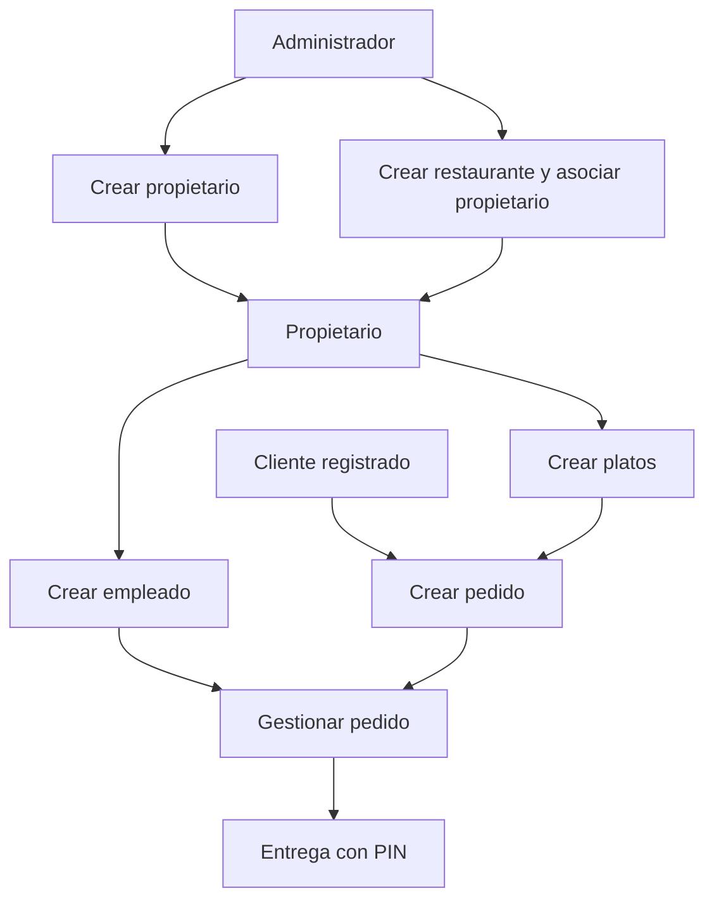
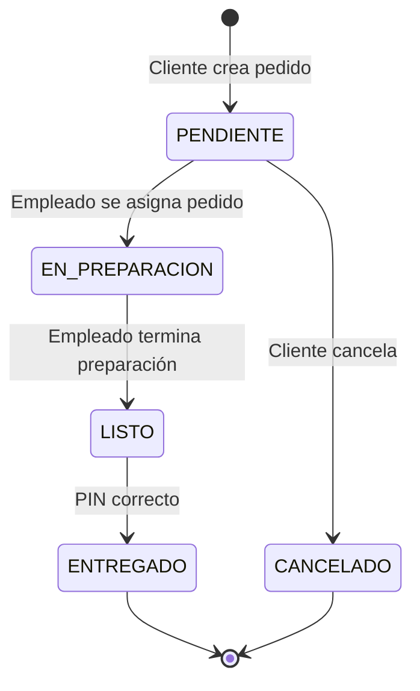

# Manual de usuario — Plaza de Comidas

Guía funcional para la utilización y evaluación académica del sistema.

[Volver al README](../README.md) · [Arquitectura](ARQUITECTURA.md) · [API REST](API-REST.md) · [Pruebas](PRUEBAS.md)

## 1. Objetivo y alcance

Este manual describe las operaciones disponibles para los roles ADMINISTRADOR, PROPIETARIO, EMPLEADO y CLIENTE. Los ejemplos son ilustrativos y deben adaptarse a los datos registrados en la instalación. No incluyen credenciales reales.

## 2. Acceso al sistema

### 2.1. Iniciar la aplicación

En Windows, desde la raíz de `plazoleta-frontend`, abrir PowerShell 7.5 o superior y ejecutar:

```powershell
.\scripts\iniciar-proyecto.ps1
```

Seguir las instrucciones del [README general](../README.md) para configurar los requisitos, MySQL, las variables de entorno y Twilio. En una instalación nueva, configurar el administrador inicial cuando se solicite. Si ya existe un administrador en la base de datos, el bootstrap no lo reemplaza.

Abrir <http://localhost:4200> cuando los servicios estén disponibles. No es necesario utilizar Swagger para las operaciones normales del usuario.

### 2.2. Iniciar y cerrar sesión

1. Introducir el correo electrónico y la contraseña de la cuenta registrada.
2. Enviar el formulario de inicio de sesión.
3. Acceder al panel correspondiente al rol asignado.
4. Al terminar, utilizar la opción de cerrar sesión.

Si las credenciales son incorrectas, revisar los datos sin compartir la contraseña. Si la sesión expira, iniciar sesión nuevamente. Cada cuenta debe utilizar únicamente las funcionalidades autorizadas para su rol.

## 3. Roles y responsabilidades

| Rol | Responsabilidad | Cuenta creada por |
|---|---|---|
| ADMINISTRADOR | Administrar propietarios y restaurantes | Configuración inicial del sistema |
| PROPIETARIO | Gestionar catálogo, empleados e indicadores | Administrador |
| EMPLEADO | Preparar y entregar pedidos | Propietario |
| CLIENTE | Consultar oferta, pedir y seguir pedidos | Registro de cliente |



## 4. Panel del administrador

### 4.1. Registrar un propietario

1. Iniciar sesión como administrador.
2. Acceder a la gestión de propietarios y abrir el formulario de creación.
3. Completar nombre, apellido, documento, celular, fecha de nacimiento, correo y contraseña según los campos solicitados.
4. Verificar que el propietario sea mayor de edad y que sus datos sean válidos.
5. Guardar y comprobar que la cuenta aparezca en el listado.

El documento y el correo deben respetar las restricciones de unicidad del sistema. Utilizar una contraseña segura y comunicarla al titular por un canal privado.

### 4.2. Registrar un restaurante

1. Acceder a la gestión de restaurantes.
2. Abrir el formulario de creación.
3. Introducir nombre, NIT, dirección, teléfono y URL del logo.
4. Seleccionar un propietario registrado que cumpla las reglas de asignación.
5. Guardar y verificar el restaurante en el listado.

Ejemplo de datos para una demostración (adaptar a las validaciones del formulario):

| Campo | Ejemplo |
|---|---|
| Nombre | Restaurante Sabores |
| NIT | 900123456 |
| Dirección | Calle 10 # 20-30 |
| Teléfono | 3001234567 |
| Logo | URL válida de una imagen disponible |
| Propietario | Cuenta creada en el paso anterior |

### 4.3. Verificación

Comprobar que el restaurante quedó asociado al propietario correcto. Cerrar sesión antes de ingresar con la cuenta del propietario.

## 5. Panel del propietario

### 5.1. Consultar el restaurante

Iniciar sesión como propietario y consultar la información de su establecimiento. Si no aparece un restaurante asociado, solicitar al administrador que verifique la asignación.

### 5.2. Crear platos

1. Abrir la gestión del catálogo y el formulario de creación.
2. Introducir nombre, descripción, precio, categoría y URL de imagen.
3. Seleccionar la categoría admitida por el formulario.
4. Guardar y verificar el plato en el catálogo.

| Campo | Ejemplo |
|---|---|
| Nombre | Hamburguesa artesanal |
| Descripción | Hamburguesa con queso y vegetales |
| Precio | 25000 |
| Categoría | Una categoría disponible en el formulario |
| Imagen | URL válida de una imagen disponible |

El precio debe ser un entero positivo. La imagen debe ser accesible desde el navegador.

### 5.3. Modificar y gestionar disponibilidad

Seleccionar el plato y utilizar la opción de edición para actualizar su precio o descripción. La edición no permite cambiar el nombre, categoría, imagen ni restaurante mediante la operación de modificación implementada.

Utilizar las acciones de habilitación o deshabilitación para controlar su disponibilidad. Un plato deshabilitado no debe poder solicitarse en un pedido nuevo. La eliminación lógica, cuando se utiliza la acción correspondiente, es distinta de la deshabilitación; no equivale a borrar físicamente la fila de la base de datos.

### 5.4. Registrar empleados

1. Acceder a la gestión de empleados.
2. Completar el formulario con los datos personales y de acceso solicitados.
3. Guardar la cuenta vinculada al restaurante correspondiente.
4. Entregar las credenciales al empleado de forma privada.
5. Verificar que el empleado pueda iniciar sesión y consultar su restaurante.

### 5.5. Consultar estadísticas

Acceder al apartado de estadísticas o eficiencia para consultar los tiempos de los pedidos y el ranking de empleados. Interpretar los resultados según los datos y unidades que presenta la interfaz. En una instalación nueva puede no haber información suficiente hasta completar pedidos.

## 6. Panel del cliente

### 6.1. Registro

Desde la pantalla de acceso, abrir el formulario de registro de cliente. Completar nombre, apellido, documento, celular, correo y contraseña. No se requiere fecha de nacimiento para el registro del cliente. Enviar el formulario e iniciar sesión con la cuenta creada.

Para el celular colombiano se admiten diez dígitos comenzando por 3, o el mismo número precedido por `+57`. Para una prueba real de SMS, utilizar un número propio o autorizado y capaz de recibir mensajes.

### 6.2. Explorar restaurantes y platos

1. Acceder al listado de restaurantes.
2. Seleccionar el establecimiento deseado.
3. Consultar los platos disponibles y sus precios.
4. Utilizar los filtros de catálogo cuando estén disponibles.
5. Seleccionar los productos deseados.

### 6.3. Crear un pedido

1. Agregar platos al carrito.
2. Ajustar las cantidades y retirar los productos no deseados.
3. Revisar el restaurante, los productos y el importe mostrado.
4. Confirmar el pedido.
5. Verificar que se haya registrado y aparezca como PENDIENTE.

Todos los platos deben pertenecer al mismo restaurante, estar disponibles y tener cantidades positivas. Solo se admite un pedido activo por cliente. No confirmar repetidamente mientras se procesa una solicitud.

### 6.4. Consultar el pedido activo

Abrir **Mi pedido activo** para revisar los platos y el estado del pedido. La implementación consulta periódicamente el backend cada cinco segundos durante el seguimiento. Si no hay pedido activo, se muestra la situación correspondiente; esto no constituye por sí mismo un fallo.

### 6.5. Cancelar un pedido

Mientras el pedido se encuentre PENDIENTE, utilizar la opción de cancelación y confirmar si la interfaz lo solicita. Verificar el resultado. Si el empleado ya inició la preparación, la cancelación debe ser rechazada por las reglas de negocio.

### 6.6. Recibir el pedido

Cuando el pedido se marque LISTO, el sistema activa la notificación correspondiente. En modo Twilio, revisar el SMS recibido en el celular registrado. Presentar el PIN de seis dígitos al empleado únicamente al momento de recibir el pedido. No compartirlo públicamente.

Después de la entrega, verificar que el pedido deje de aparecer como activo. Consultar la trazabilidad cuando la interfaz permita acceder al pedido correspondiente.

## 7. Panel del empleado

### 7.1. Consultar pedidos

Iniciar sesión como empleado y consultar los pedidos del restaurante asociado. Seleccionar el estado correspondiente para localizar los pedidos pendientes, en preparación o listos.

### 7.2. Asignar e iniciar preparación

1. Localizar un pedido PENDIENTE.
2. Revisar los platos y cantidades.
3. Ejecutar la acción de asignación.
4. Verificar que el pedido avance a EN_PREPARACION.

La asignación inicia la preparación en la implementación actual; no se requiere una transición adicional independiente.

### 7.3. Marcar como listo

Una vez preparados todos los platos, ejecutar la acción para marcar el pedido como LISTO. Comprobar el cambio de estado. Esta operación activa el flujo de notificación al cliente.

### 7.4. Confirmar la entrega

1. Localizar el pedido LISTO.
2. Solicitar al cliente el PIN recibido.
3. Introducir los seis dígitos, incluidos los ceros iniciales si existen.
4. Confirmar la entrega.
5. Verificar el resultado ENTREGADO.

Si el PIN es incorrecto, no entregar ni dar por finalizado el pedido. Revisar el código con el cliente y volver a intentar con el PIN correcto. No intentar adivinar códigos ni registrar el PIN en documentos o capturas públicas.

## 8. Ciclo de vida y reglas



| Estado | Significado | Acción siguiente |
|---|---|---|
| PENDIENTE | Pedido registrado | Asignar o cancelar |
| EN_PREPARACION | Pedido asignado | Marcar listo |
| LISTO | Preparación terminada | Confirmar entrega con PIN |
| ENTREGADO | Entrega confirmada | Estado final |
| CANCELADO | Pedido cancelado | Estado final |

No se deben omitir estados ni intentar operar sobre pedidos de otros usuarios o restaurantes sin autorización.

## 9. Notificaciones SMS

El modo real requiere una configuración válida de Twilio, un remitente autorizado y un destinatario compatible con las condiciones de la cuenta. Consultar el README para configurar el proveedor. Las cuentas de prueba pueden exigir verificar previamente el destinatario.

El modo simulado permite ejecutar el flujo sin enviar un SMS real. No asumir que el PIN se imprime en los logs: la implementación evita exponerlo. Para demostrar la entrega desde la interfaz con recepción del PIN, utilizar el modo real correctamente configurado.

Si no llega el mensaje, verificar el celular registrado, el estado del pedido y la configuración del proveedor. El responsable técnico puede consultar los registros de ejecución sin publicar credenciales ni códigos. No asumir que existe una opción de reenvío automático.

## 10. Guion de evaluación integral

Utilizar cuentas de demostración y datos autorizados. Para observar simultáneamente dos roles, emplear perfiles de navegador independientes o una ventana privada adicional, evitando que una sesión sustituya a la otra.

| Paso | Rol | Operación | Resultado esperado |
|---|---|---|---|
| 1 | Administrador | Crear propietario | Cuenta registrada |
| 2 | Administrador | Crear restaurante | Asociación correcta |
| 3 | Propietario | Crear dos platos | Catálogo disponible |
| 4 | Propietario | Crear empleado | Cuenta asociada |
| 5 | Cliente | Registrarse e iniciar sesión | Panel de cliente |
| 6 | Cliente | Agregar platos y confirmar | PENDIENTE |
| 7 | Cliente | Consultar seguimiento | Pedido activo visible |
| 8 | Empleado | Asignar pedido | EN_PREPARACION |
| 9 | Empleado | Marcar listo | LISTO y flujo SMS |
| 10 | Empleado | Introducir PIN incorrecto | Entrega rechazada |
| 11 | Empleado | Introducir PIN correcto | ENTREGADO |
| 12 | Cliente | Consultar pedido activo | Sin pedido activo |
| 13 | Propietario | Consultar estadísticas | Indicadores según datos registrados |
| 14 | Cliente | Crear otro pedido y cancelar antes de asignación | CANCELADO |

### Evidencias recomendadas

Registrar capturas del catálogo, creación del pedido, seguimiento, cambios de estado, confirmación de entrega y estadísticas. Ocultar datos personales, contraseñas, PIN y credenciales de servicios externos. Registrar fecha, resultado esperado y resultado observado de cada escenario.

## 11. Solución de problemas frecuentes

| Situación | Acción recomendada |
|---|---|
| No abre la aplicación | Verificar que el script de inicio haya finalizado correctamente y acceder a localhost:4200 |
| Credenciales rechazadas | Revisar correo y contraseña; confirmar que la cuenta existe |
| Propietario sin restaurante | Solicitar al administrador verificar la asociación |
| Plato no disponible | Consultar al propietario y revisar el estado del catálogo |
| No se puede crear otro pedido | Revisar si existe un pedido activo |
| Cancelación rechazada | Comprobar que el pedido siga PENDIENTE |
| No llega el SMS | Revisar celular, proveedor y configuración con el responsable técnico |
| PIN rechazado | Verificar los seis dígitos y el estado LISTO |
| Estadísticas vacías | Comprobar que existan pedidos procesados en el restaurante |
| Error de conexión | Revisar servicios, MySQL y logs según el README |

## 12. Finalizar la sesión y detener el sistema

Cerrar sesión en las cuentas utilizadas. Si se administra la instalación local, esperar a que terminen las operaciones en curso y ejecutar desde la raíz del frontend:

```powershell
.\scripts\detener-proyecto.ps1
```

El script detiene los procesos registrados del frontend y los cuatro microservicios; no detiene MySQL ni elimina los datos almacenados. No ejecutar durante una operación de escritura o entrega en curso.

## 13. Alcance de la guía

Este manual describe recorridos funcionales a partir de la documentación del proyecto. Los nombres exactos de botones y la distribución visual pueden variar según la versión del frontend. No se incluyen capturas de una ejecución nueva ni se afirma que los escenarios de esta guía se hayan vuelto a ejecutar. La validación integral de una instalación limpia debe registrarse por separado.
