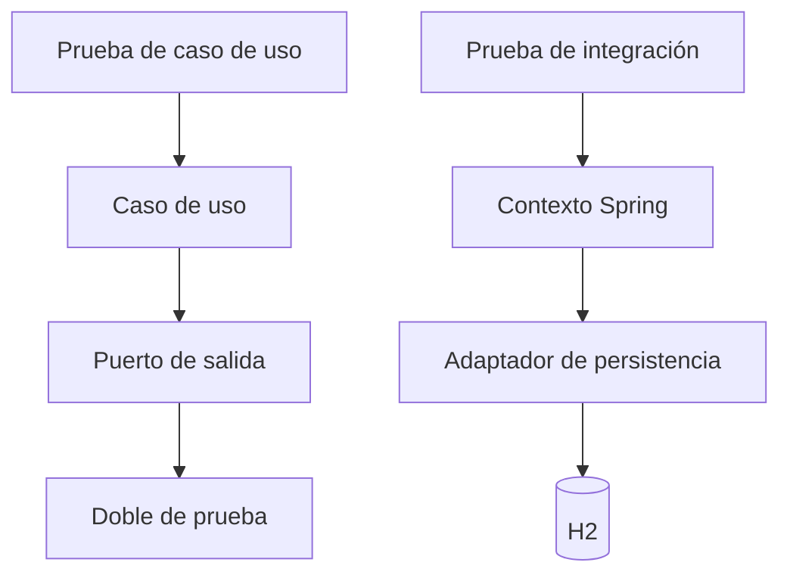
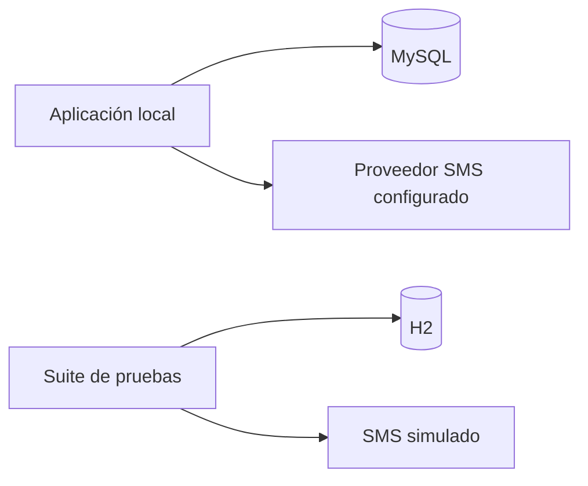
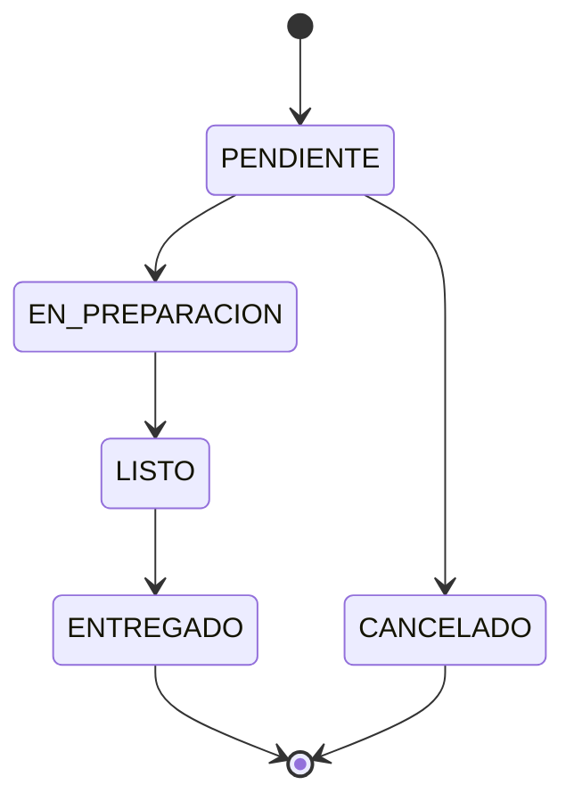

# Estrategia de pruebas automatizadas — Plaza de Comidas

[Volver al README general](../README.md)

## 1. Objetivo y alcance

La estrategia de pruebas verifica las reglas de negocio, los contratos HTTP, los adaptadores y la integración de los cuatro microservicios Java 21 / Spring Boot. Complementa la validación funcional desde Angular y Swagger. Los resultados del backend no equivalen a cobertura total del código ni a una certificación de seguridad.

## 2. Organización de las pruebas

Cada microservicio mantiene sus propias pruebas bajo `src/test/java/com/plazoleta/<microservicio>/tests/`. El nombre del paquete es **tests**, en plural. El test de arranque del contexto puede encontrarse directamente en el paquete raíz del servicio.

```text
src/test/
├── java/com/plazoleta/<microservicio>/
│   └── tests/
│       ├── adapter/
│       ├── controller/
│       ├── integration/
│       └── usecase/
└── resources/
```

| Categoría | Responsabilidad |
|---|---|
| usecase | Reglas de negocio, validaciones y coordinación de puertos |
| controller | Contratos HTTP, validaciones de entrada y respuestas |
| adapter | Transformación de datos y comportamiento de adaptadores |
| integration | Interacción entre componentes y persistencia de prueba |
| Arranque | Carga del contexto Spring |

La estructura representa la organización adoptada; los archivos concretos se consultan en cada repositorio.

## 3. Arquitectura hexagonal y estrategia de aislamiento

Los casos de uso dependen de puertos, lo que permite sustituir las implementaciones externas por dobles de prueba cuando corresponde. Las pruebas de infraestructura complementan esta verificación comprobando los adaptadores concretos.



Las excepciones de negocio deben conservar los mensajes definidos en `MensajesError`, evitando literales duplicados en los casos de uso.

## 4. Entorno de pruebas y persistencia

La ejecución normal utiliza MySQL. La configuración de pruebas utiliza H2 para separar los datos de prueba de los datos operativos. No se debe sustituir la configuración normal de MySQL por H2 para ejecutar la aplicación.

| Aspecto | Ejecución normal | Pruebas automatizadas |
|---|---|---|
| Persistencia | MySQL | H2 en las pruebas que requieren persistencia |
| Administrador inicial | Configurable | Bootstrap deshabilitado |
| SMS en order-service | Twilio o proveedor simulado según configuración | Proveedor simulado |
| Datos | Registros operativos | Datos propios de las pruebas |



H2 reduce la dependencia de infraestructura externa y evita que las pruebas de persistencia actúen sobre las bases de datos operativas. No reproduce necesariamente todas las particularidades de MySQL; la validación funcional con MySQL sigue siendo necesaria.

Antes de ejecutar una suite modificada, comprobar sus perfiles, configuración de datasource y proveedor SMS. No ejecutar pruebas destructivas contra una base operativa.

## 5. Escenarios funcionales de referencia

La siguiente matriz identifica comportamientos relevantes para la evaluación y mantenimiento. No es un inventario exhaustivo de métodos de prueba ni afirma cobertura individual de cada escenario.

| Servicio | Escenarios positivos | Escenarios negativos |
|---|---|---|
| user-service | Registro, autenticación, creación de usuarios autorizados | Datos inválidos, credenciales incorrectas, permisos insuficientes |
| restaurant-service | Creación y consulta de restaurantes, validación de propietario | Restaurante inexistente, propietario inválido, acceso no autorizado |
| dish-service | Creación, actualización y disponibilidad de platos | Precio inválido, restaurante ajeno, datos incompletos |
| order-service | Creación, asignación, preparación, entrega y trazabilidad | Segundo pedido activo, transición inválida, PIN incorrecto, acceso indebido |

### 5.1. Ciclo de vida del pedido



Comprobar las transiciones permitidas, el rechazo de las no permitidas, la asignación del empleado y la correspondencia entre el estado actual y el historial. La cancelación está sujeta a las reglas del negocio.

### 5.2. Seguridad

Verificar autenticación, autorización por roles, propiedad de recursos y protección de operaciones internas. Un token válido no concede acceso indiscriminado a todos los recursos. Las pruebas de seguridad funcional no sustituyen una auditoría integral.

### 5.3. Integración SMS

Las pruebas automatizadas de pedidos utilizan el proveedor simulado para evitar envíos reales, consumo de saldo y dependencia de Twilio. La validación manual previa con Twilio confirmó la recepción de SMS y el rechazo de un PIN incorrecto, seguido de la aceptación del PIN correcto. Esta comprobación externa es distinta de la suite automatizada.

## 6. Requisitos de ejecución

- JDK 21 y `JAVA_HOME` correctamente configurado.
- Maven Wrapper de cada microservicio.
- Acceso a Internet para descargar dependencias cuando no estén en caché.
- PowerShell 7.5 o superior para los scripts de automatización en Windows.

No es necesario instalar Maven globalmente si el wrapper está completo. Las suites aisladas no requieren credenciales reales de Twilio ni una base MySQL operativa.

## 7. Ejecución individual

Desde la raíz del microservicio que se desea verificar:

```powershell
.\mvnw.cmd clean test
```

Para compilar y ejecutar las pruebas:

```powershell
.\mvnw.cmd clean package
```

Para ejecutar una clase concreta, por ejemplo en dish-service:

```powershell
.\mvnw.cmd test '-Dtest=CrearPlatoUseCaseTest'
```

Para recorrer el ciclo de verificación de Maven:

```powershell
.\mvnw.cmd clean verify
```

La ejecución de pruebas de integración durante `verify` depende de cómo estén configurados los plugins y las clases en el `pom.xml`.

## 8. Ejecución conjunta

Desde `plazoleta-frontend`, con los cuatro repositorios hermanos disponibles, se pueden ejecutar las suites sin iniciar el frontend ni los servidores HTTP:

```powershell
$workspace = Split-Path (Get-Location).Path -Parent
$servicios = @('user-service', 'restaurant-service', 'dish-service', 'order-service')
foreach ($servicio in $servicios) {
    Push-Location (Join-Path $workspace $servicio)
    try {
        Write-Host "Ejecutando pruebas: $servicio"
        & .\mvnw.cmd clean test
        if ($LASTEXITCODE -ne 0) {
            throw "Fallaron las pruebas de $servicio"
        }
    }
    finally {
        Pop-Location
    }
}
```

Se recomienda detener previamente el proyecto para evitar conflictos con archivos JAR en uso.

### Ejecución mediante el script principal

```powershell
.\scripts\iniciar-proyecto.ps1 -EjecutarPruebas
```

Este comando configura el entorno, compila los servicios ejecutando las pruebas y posteriormente inicia la aplicación completa. Requiere los requisitos de ejecución normal, incluido MySQL. No combinar `-EjecutarPruebas` con `-OmitirCompilacion`.

El inicio predeterminado utiliza `-DskipTests` para acelerar la compilación; no constituye evidencia de una nueva ejecución exitosa de pruebas.

## 9. Resultados registrados

| Microservicio | Pruebas superadas |
|---|---:|
| user-service | 137 |
| restaurant-service | 176 |
| dish-service | 114 |
| order-service | 266 |
| **Total** | **693** |

Estos resultados corresponden a ejecuciones exitosas previas del proyecto. No se han generado nuevos informes al redactar este documento. El total no incluye pruebas de Angular ni equivale a un porcentaje de cobertura.

## 10. Informes y evidencia reproducible

Maven Surefire normalmente genera informes en `target/surefire-reports/`. Si se utiliza Failsafe, consultar también `target/failsafe-reports/` cuando exista.

```powershell
Get-ChildItem .\target\surefire-reports -Filter 'TEST-*.xml'
```

Para consolidar los resultados Surefire de la ejecución actual de un servicio:

```powershell
$informes = @(Get-ChildItem .\target\surefire-reports -Filter 'TEST-*.xml')
if ($informes.Count -eq 0) { throw 'No hay informes de pruebas.' }
$filas = foreach ($informe in $informes) {
    $suite = ([xml](Get-Content $informe.FullName -Raw)).testsuite
    [pscustomobject]@{
        Pruebas = [int]$suite.tests
        Fallos = [int]$suite.failures
        Errores = [int]$suite.errors
        Omitidas = [int]$suite.skipped
    }
}
foreach ($campo in @('Pruebas','Fallos','Errores','Omitidas')) {
    Write-Host "${campo}: $(($filas | Measure-Object -Property $campo -Sum).Sum)"
}
```

Ejecutar `clean test` antes de recopilar informes para evitar resultados residuales. Revisar también el código de salida de Maven y cualquier informe adicional de integración. Conservar la fecha y el commit evaluado cuando se preparen evidencias académicas.

## 11. Validación funcional complementaria

Con el sistema iniciado mediante `iniciar-proyecto.ps1`, comprobar:

1. Administrador: crear propietario y restaurante.
2. Propietario: crear platos y empleados, modificar disponibilidad y consultar estadísticas.
3. Cliente: registrarse, consultar restaurantes, agregar platos al carrito y crear un pedido.
4. Empleado: asignarse el pedido, iniciar preparación y marcarlo como listo.
5. Cliente: consultar el seguimiento del pedido activo y recibir el PIN mediante el proveedor configurado.
6. Empleado: rechazar un PIN incorrecto y confirmar la entrega con el correcto.
7. Verificar historial y estadísticas, así como la posibilidad de crear un nuevo pedido después de finalizar el anterior.

Utilizar datos de demostración autorizados. No publicar teléfonos, contraseñas, tokens ni PIN reales en capturas o informes.

## 12. Diagnóstico

| Problema | Acción recomendada |
|---|---|
| Java incompatible | Revisar `java -version` y `JAVA_HOME` |
| Error de dependencias | Revisar conexión y salida de Maven Wrapper |
| Conexión inesperada a MySQL | Detener la prueba y revisar perfil y datasource |
| Intento de SMS real | Revisar la configuración de pruebas de order-service |
| Error al cargar el contexto | Revisar la primera causa de la excepción y las propiedades de prueba |
| Fallo de aserción | Comparar resultado esperado, resultado real y regla de negocio |
| JAR bloqueado | Detener la aplicación antes de recompilar |

## 13. Criterios de aceptación y limitaciones

Una ejecución satisfactoria requiere código de salida cero, ausencia de fallos y errores, y revisión explícita de pruebas omitidas. Los resultados deben corresponder a la revisión de código que se pretende entregar.

No se dispone aquí de una medición de cobertura, una nueva auditoría de seguridad ni resultados cuantificados de pruebas automatizadas del frontend. La instalación desde cero y el bootstrap del administrador en una base nueva requieren validación adicional. Las pruebas con H2 no sustituyen las verificaciones con MySQL y Twilio reales.

## 14. Referencias internas

- [Arquitectura](ARQUITECTURA.md)
- [Base de datos](BASE-DE-DATOS.md)
- [API REST](API-REST.md)
- [README general](../README.md)
